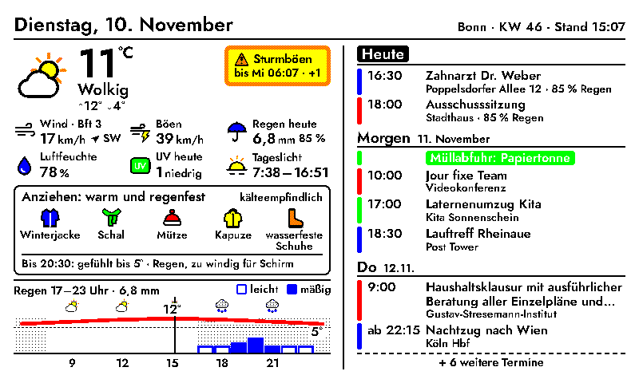
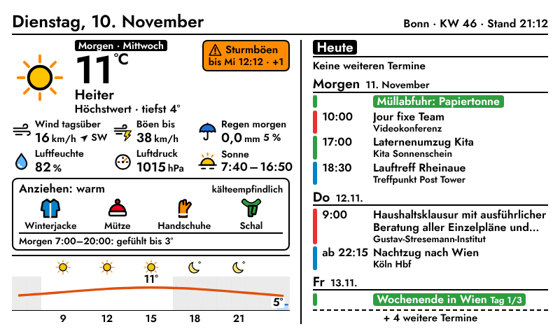
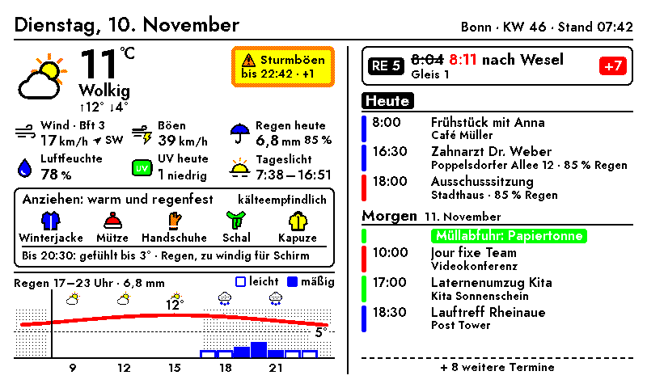
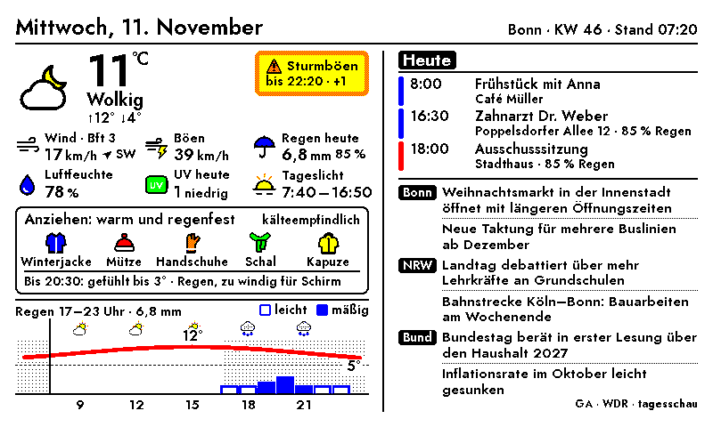
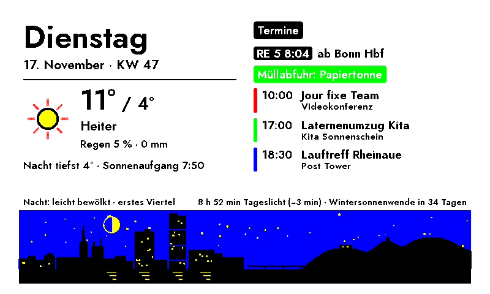
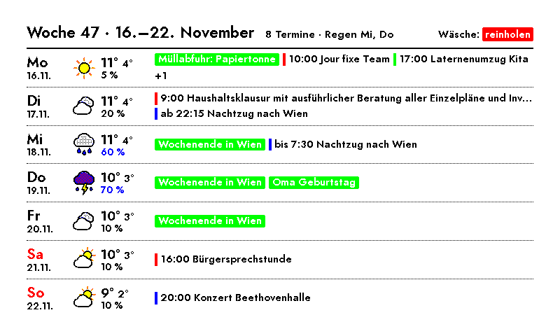

# InkyPi – Tagesdashboard (Wetter & Kalender)

Ein eigenständiges InkyPi-Plugin: links das Wetter vom Deutschen Wetterdienst mit Kleidungsempfehlung, rechts die Termine aus Nextcloud.








*Die Screenshots zeigen Testdaten.*

## Installation

Aus einem GitHub-Repository, in dem der Ordner `tagesdashboard` im Wurzelverzeichnis liegt:

```bash
inkypi plugin install tagesdashboard https://github.com/<dein-name>/InkyPi-Tagesdashboard
```

Oder von Hand:

```bash
cp -r tagesdashboard ~/InkyPi/src/plugins/
sudo systemctl restart inkypi.service
```

Danach unter **API Keys** den Schlüssel `NEXTCLOUD_APP_PASSWORD` mit einem App-Passwort aus Nextcloud anlegen (Einstellungen → Sicherheit → „Neues App-Passwort erstellen“). In der Web-Oberfläche „Wetter & Kalender“ öffnen und Ort sowie Nextcloud-Zugang eintragen.

Zusätzliche Python-Pakete braucht das Plugin nicht: `requests`, `astral`, `icalendar` und `recurring-ical-events` bringt InkyPi schon mit.

**Empfohlenes Aktualisierungsintervall:** 15–30 Minuten (mit Zuganzeige 5 Minuten, siehe unten).

## Funktionen

- **Wetter (DWD):** aktuelle Werte, amtliche Warnungen und sechs Messwerte: Wind, Böen, Niederschlag, Luftfeuchte, UV-Index mit Stufe (niedrig bis extrem) und Sonnenzeiten.
- **Tageskurve** von 6 bis 24 Uhr mit „jetzt“-Linie. Darunter eine eigene Regenzeile: Die Balkenhöhe zeigt die Menge pro Stunde, die Füllung die Stärke (leicht: umrandet, mäßig: blau, stark: rot). Die Kopfzeile nennt Zeitraum und Summe, zum Beispiel „Regen 17–23 Uhr · 6,8 mm“.
- **Abends das Wetter von morgen:** ab einer einstellbaren Uhrzeit, Standard 20 Uhr.
- **Kleidungsempfehlung:** für die Zeit, in der man unterwegs ist, also bis zum Ende des letzten Termins. Das Kälteempfinden ist einstellbar: normal, empfindlich oder sehr empfindlich.
- **Termine (Nextcloud per CalDAV):** Kalenderfarben, Serientermine, ganztägige und mehrtägige Termine. Steigt das Regenrisiko während eines Termins auf mindestens 50 %, steht es am Termin.
- **Nachrichten am Morgen:** werktags 6:00–9:30, am Wochenende 8:00–10:30 Uhr zeigt die rechte Spalte nur die heutigen Termine und darunter Schlagzeilen für Bonn (General-Anzeiger), NRW (WDR) und Bund (tagesschau). Ohne Liveblogs und doppelte Themen; quer bis zu zwei, hochkant bis zu drei pro Ebene, je nach Platz. Quellen und Zeiten sind einstellbar.
- **Wäsche auf dem Balkon:** abends 17–23 Uhr eine Karte über den Terminen: „reinholen“ (Regen, Schnee, Sturmböen), „besser rein“ (Regen möglich, Nebel, Tau, Frost) oder „kann bleiben“ – geprüft bis morgen 10 Uhr. Für überdachte Balkone einstellbar.
- **Nachtbild:** 23–6 Uhr ein ruhiges Bild für den kommenden Tag: Wochentag, Wetter, tiefste Nachttemperatur, Sonnenaufgang, Termine, Zug, Mondphase. Unten ein Band mit der Bonner Silhouette – Münster, Langer Eugen, Post Tower, Kennedybrücke, Siebengebirge –, dessen Himmel das Wetter der Nacht zeigt (Sterne, Wolken, Regen, Schnee, Nebel, Mond), dazu Tageslicht und Countdown zur Sonnenwende. Es wird einmal gezeichnet und bleibt bis zum Morgen stehen.
- **Wochenvorschau:** sonntags 18–23 Uhr die kommende Woche Mo–So in Zeilen mit Wetter, Regenwahrscheinlichkeit und Terminen.
- **Zug (optional):** an ausgewählten Wochentagen in einem Zeitfenster eine Karte über den Terminen mit den Live-Daten eines Zuges, z. B. dienstags 6:30–8:15 Uhr der RE 5 ab Bonn Hbf um 8:04 Uhr: Verspätung mit neuer Abfahrtszeit, Gleiswechsel, Ausfall, vorzeitiges Zugende. Daten: Timetables-API der Deutschen Bahn (CC BY 4.0).
- **Robust:** Fällt der Kalender oder das Wetter aus, zeigt das Dashboard den anderen Teil trotzdem an.
- **Layout:** Quer- und Hochformat; optimiert für E-Ink mit halbfetter Schrift und ohne grauen Text. Die Farben werden auf die sechs Displayfarben eingerastet (siehe unten).

## Nachrichten

Sind ab dem Update eingeschaltet. In den Einstellungen unter „Nachrichten am Morgen“ lassen sich Zeitfenster und Feeds ändern. Für Bonn werden aus dem GA-Feed nur Artikel genommen, deren Adresse `/bonn/` enthält; reicht das nicht, ergänzt das Dashboard WDR-Meldungen, in denen Bonn vorkommt. Fällt ein Feed aus, fehlt nur diese Ebene. Feiertage zählen als Werktage.

Test auf dem Pi, ob die Feeds antworten:

```bash
for u in https://ga.de/feed.rss https://www1.wdr.de/uebersicht-100.feed https://www.tagesschau.de/index~rss2.xml; do
  echo "== $u"; curl -s "$u" | grep -o '<title>[^<]*' | sed 's/<title>//' | sed -n '2,6p'
done
```

## Zug einrichten

1. In den Dashboard-Einstellungen unter „Zug“ das Häkchen setzen und Bahnhof, Linie, planmäßige Abfahrt, Zeitfenster und Wochentage eintragen. Speichern.
2. Damit die Zugdaten im Zeitfenster aktuell sind: unter **Settings** das Wechselintervall (Plugin Cycle Interval) auf **5 Minuten**, im Playlist-Eintrag des Dashboards die Aktualisierung (Refresh) ebenfalls auf **5 Minuten**. Außerhalb des Zeitfensters zeichnet das Dashboard nur im eingestellten Takt neu (Standard 15 Minuten, einstellbar unter „Zug“). InkyPi vergleicht die Bilder und zeichnet das Display dann nicht neu, es flackert also nicht alle 5 Minuten.
3. Optional, aber empfohlen: kostenlos beim [DB API Marketplace](https://developers.deutschebahn.com/) registrieren, eine Anwendung anlegen und die API „Timetables“ abonnieren. Client-ID und API-Key unter **API Keys** als `DB_CLIENT_ID` und `DB_API_KEY` eintragen. Ohne Schlüssel nutzt das Dashboard die öffentliche Abfahrtstafel der Bahn (`iris.noncd.db.de`); die ist inoffiziell und kann wegfallen.

Die Karte zeigt: Linie, Abfahrt (bei Verspätung die alte Zeit durchgestrichen, die neue rot), Ziel, Gleis (gelb markiert bei Gleiswechsel), Hinweise wie „endet in Köln Hbf“ und rechts den Status: pünktlich (grün), +1 bis +4 (gelb), ab +5 und „fällt aus“ (rot), „abgefahren“. Fehlen die Live-Daten, ist die Karte gestrichelt umrandet.

## Schärfer auf dem Inky Impression

Das Inky Impression 7,3″ kann nur sechs Farben darstellen. Alles andere setzt der Treiber aus farbigen Pünktchen zusammen, dabei fransen Schrift und Linien aus. Zwei Maßnahmen machen das Bild deutlich schärfer:

**1. Farben einrasten (im Plugin, standardmäßig an).** Das Plugin legt jedes Pixel selbst auf eine der sechs Displayfarben fest, bevor das Bild zum Treiber geht. Kanten bleiben dadurch glatt, kräftige Farben werden einfarbig. Nur Graustufen und helle Töne (zum Beispiel die Nachtstunden im Graphen) erscheinen als feines, gleichmäßiges Punktmuster. Abschalten lässt es sich in den Plugin-Einstellungen: „Schärfer auf Inky-Displays“.

Damit das wirkt, in InkyPi unter den Bildeinstellungen (Image Settings) Sättigung, Kontrast, Schärfe und Helligkeit auf **1,0** lassen. Die Inky-Sättigung (`inky_saturation`) bei **0,5 oder weniger** einstellen. Andere Werte verfälschen die Farben wieder; das Plugin schreibt dann eine Warnung ins Log.

**2. Schrift am Pixelraster ausrichten (einmalig auf dem Pi).** Diese Einstellung schaltet den Autohinter von FreeType ein. Er richtet alle Striche einer Schriftgröße auf dieselbe Pixelbreite aus. Die grauen Kantenpixel der geglätteten Schrift macht danach das Einrasten (Punkt 1) hart schwarz oder weiß. So entstehen gleichmäßige Buchstaben ohne graue Ränder:

```bash
sudo tee /etc/fonts/local.conf > /dev/null <<'XML'
<?xml version="1.0"?>
<!DOCTYPE fontconfig SYSTEM "fonts.dtd">
<fontconfig>
  <match target="font">
    <edit name="antialias" mode="assign"><bool>true</bool></edit>
    <edit name="hinting" mode="assign"><bool>true</bool></edit>
    <edit name="autohint" mode="assign"><bool>true</bool></edit>
    <edit name="hintstyle" mode="assign"><const>hintfull</const></edit>
    <edit name="rgba" mode="assign"><const>none</const></edit>
    <edit name="lcdfilter" mode="assign"><const>lcdnone</const></edit>
  </match>
</fontconfig>
XML
fc-cache -f
sudo systemctl restart inkypi.service
```

Der Befehl überschreibt eine vorhandene `/etc/fonts/local.conf`. Er gilt für alle Programme auf dem Pi, die fontconfig nutzen, also auch für andere InkyPi-Plugins. Rückgängig machen: `sudo rm /etc/fonts/local.conf` und InkyPi neu starten.

Bitte nicht Schrift ganz ohne Kantenglättung (`antialias=false`) verwenden. Dann rundet FreeType jeden Buchstaben einzeln auf ganze Pixel, und die Striche werden ungleich dick: „n“ und „m“ wirken dünn, „H“ und Ziffern fett.

**Vorschau:** Die Vorschau in der InkyPi-Weboberfläche zeigt das eingerastete Bild. So sieht es auf dem Display aus, nur leuchtender.

## Aufbau

```
tagesdashboard/
├── tagesdashboard.py        # Kombiniert Wetter und Termine, Tageskurve, Zeitfenster
├── kleidung.py              # Regeln und Symbole der Kleidungsempfehlung
├── bahn.py                  # Live-Daten eines Zuges (DB Timetables-API)
├── nachrichten.py           # Morgen-Schlagzeilen aus RSS-Feeds
├── waesche.py               # Abends: Wäsche reinholen?
├── ansichten.py             # Nachtbild und Wochenvorschau
├── nachtgrafik.py           # Bonner Silhouette fürs Nachtbild
├── settings.html            # Einstellungsseite (deutsch)
├── plugin-info.json
├── icon.png
├── render/                  # Template und Layout
└── lib/                     # Mitgelieferte Bausteine
    ├── dwd_wetter.py        #   Wetterabruf (Bright Sky / DWD), Warnungen, Kacheln
    ├── dwd_icons.py         #   Wetter- und Messwert-Symbole
    ├── nextcloud_kalender.py#   CalDAV-Client, Serientermine
    └── eink.py              #   Farben auf die Displayfarben einrasten
```

`lib/` enthält Kopien aus den Plugins „DWD Wetter“ und „Nextcloud Kalender“, Stand Version 1.6. Dadurch läuft das Dashboard ohne diese Plugins. Sind sie trotzdem installiert, stören sie sich nicht gegenseitig.

## Datenquellen

- Wetter: [Bright Sky](https://brightsky.dev) mit Open Data des Deutschen Wetterdienstes, ohne API-Key
- UV-Index: [UV-Gefahrenindex des DWD](https://opendata.dwd.de/climate_environment/health/alerts/) (`uvi.json`). Er wird nur für ausgewählte Orte berechnet; der Ort wird über den Namen zugeordnet. Ohne Treffer in der Einstellung „Ort für den UV-Index“ einen Ort in der Nähe eintragen, sonst zeigt die Kachel die Bewölkung.
- Termine: die eigene Nextcloud per CalDAV
- Nachrichten: RSS-Feeds von General-Anzeiger, WDR und tagesschau
- Zug: [Timetables-API der Deutschen Bahn](https://developers.deutschebahn.com/) (Deutsche Bahn AG, CC BY 4.0)

## Status

Version 1.6 (Bonner Silhouette im Nachtbild; 1.5: Nachtbild, Wochenvorschau; 1.4: Wäsche-Karte am Abend; 1.3.1: Playlist-Intervall wurde verdoppelt; 1.3: Nachrichten am Morgen; 1.2: Zug-Live-Daten; 1.1: Farben einrasten, Schrift für E-Ink). Wird aktiv gepflegt; Fehlerberichte und Pull Requests sind willkommen.

Lizenz: GPL-3.0 (wie InkyPi).
