# Tagesdashboard (Wetter & Kalender) für InkyPi – Version 1.39

Wetter vom DWD links, Nextcloud-Termine rechts, Kleidungsempfehlung, UV-Index, Pollenflug, Lauf-Fenster, Glätte-Hinweis fürs Rad, Sternschnuppenströme, Mondfinsternisse, helle Planeten und Polarlicht im Nachtbild, Zug mit Störungsmonitor, Morgen-Schlagzeilen, Wäsche-Karte, Nachtbild mit Bonner Silhouette, Wochenvorschau, Anfahrt zu Terminen, Festtage, Regenradar, Schlagzeilen aus Frankreich, Luftqualität, Streckenmeldungen und eine **kleine Katze**, die sich bei jeder Aktualisierung woanders versteckt – nachts schläft sie auf dem Mond über Bonn, mit Maus, Laserpunkt, Karton und passenden Posen zu Nachrichten, Zug, Wäsche, Geburtstag und Ratssitzung. Dazu eine **Statusanzeige** im Kopf, wenn eine Datenquelle ausfällt. Die Kleidungsempfehlung sagt, ob es **kälter oder wärmer als gestern** wird. Dazu ein **Urlaubsbild**, eine **Wahlkampf-Karte** und der **ISS-Überflug** im Nachtbild. Während einer **Ratssitzung** führt ein **QR-Code zum Livestream**. **Abgelehnte Einladungen** erscheinen nicht mehr. Während der Ratssitzung steht die Katze **am Rednerpult**. Im Nachtbild steht der **Rhein so hoch wie am Pegel Bonn**, und die Wochenvorschau sagt, **wie es dem Pi geht**. In der Adventszeit steht ein **Adventskranz** im Kopf, und die Wochenvorschau nennt die **freien Abende**. Liegt ein Termin weiter weg, etwa in Düsseldorf, steht das **Wetter am Zielort** dabei. Das **Nachtbild reicht bis an den Rand** des Displays. Ohne Zug zeichnet das Dashboard im gewohnten Takt neu statt alle 5 Minuten. Der Zugang zur Nextcloud ist besser abgesichert. Die Wetterseite ist **aufgeräumter**: weniger Kacheln, keine Rahmen, mehr Platz für die Tageskurve. Die Katze hat **55 Posen**: bei jedem Wetter mehrere, die sich abwechseln, in der Adventszeit eine Lichterkette und neu passende Posen zu Regenradar, Anfahrt, Pollen, Wahlkampf, Zielort, spätem Abend und Wochenende. Neu: **Warnungen des Bevölkerungsschutzes** (NINA) als rotes Band, in der Wochenvorschau **wie voll die Woche ist** und **wie viel du gelaufen bist**, und am Monatsersten ein **Monatsbild**.

## Installieren bzw. aktualisieren

1. Den Ordner `tagesdashboard/` aus diesem Paket nach `InkyPi/src/plugins/tagesdashboard/` kopieren (vorhandenen Ordner ersetzen).
2. `sudo systemctl restart inkypi.service` (Python-Dateien haben sich geändert).
3. In der Web-Oberfläche die Plugin-Einstellungen öffnen und einmal speichern.

## Neu in 1.39: Pi-Zeile wird nicht mehr abgeschnitten

- **Fehlerbehebung:** Gab es in einer Woche mehrere Ausfälle, wurde die Zeile „Pi: …“ unter der Wochenvorschau mitten im Wort abgeschnitten („GA 1× we…“), und alles dahinter fehlte. Jetzt wird sie sinnvoll gekürzt, bis sie passt (quer eine Zeile, hochkant zwei): erst fallen die ruhigen Werte weg (online, Temperatur, Speicher), dann verlieren die hinteren Probleme ihre Details in Klammern („Kalender 3× weg“), zuletzt werden die hintersten zu „+3 weitere“ zusammengefasst. Die vollständige Zeile steht weiter im Log (`journalctl -u inkypi.service | grep "Pi:"`). Passt die Zeile, sieht alles aus wie bisher. Keine neue Einstellung.

## Neu in 1.38: Warnungen aus NINA, volle Woche, Laufen der Woche, Monatsbild

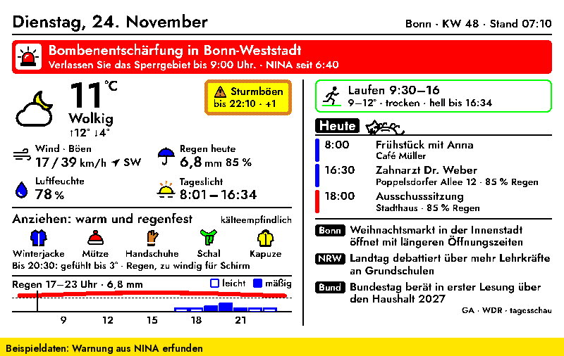

- **Warnungen des Bevölkerungsschutzes:** Meldet die Warn-App NINA (Bundesamt für Bevölkerungsschutz) etwas für deinen Wetter-Ort – Bombenentschärfung, Großbrand, verunreinigtes Trinkwasser, Hochwasser –, erscheint unter dem Kopf ein rotes Band über die ganze Breite: Titel, darunter der erste Satz der Handlungsempfehlung („Verlassen Sie das Sperrgebiet bis 9:00 Uhr.“) und seit wann die Meldung gilt; mehrere Warnungen: die wichtigste, rechts „+1 weitere“. Leichte Hinweise (z. B. Wasser abkochen) sind gelb. Das Band steht auch im Nachtbild, in der Wochenvorschau und im Monatsbild. Gezeigt werden nur Warnungen, deren Gebiet deinen Wetter-Ort enthält – eine Bombenentschärfung in einem anderen Stadtteil bleibt weg. Unwetter des DWD stehen wie bisher im Wetterbereich. Abgefragt wird höchstens alle 10 Minuten; eine neue Warnung erscheint beim nächsten Takt, auch mitten in der Nacht (das eingefrorene Nachtbild wird dann neu gezeichnet). Einstellung unter „Warnungen (NINA)“: Schalter und **Regionalschlüssel des Kreises** (Bonn 05314, Rhein-Sieg-Kreis 05382).
- **Wie voll ist die Woche?** Sonntags unter der Wochenvorschau: „Woche: 21 h Termine · deutlich mehr als sonst (Ø 12 h) · vollster Tag Di (9 h)“. Gezählt werden Termine mit Uhrzeit zwischen 7 und 23 Uhr, Überschneidungen nur einmal, ganztägige nicht (ein Nachtzug ab 22:15 zählt 45 Minuten). „Sonst“ ist der Schnitt der letzten acht Wochen; Wochen mit weniger als zwei Stunden (Urlaub) zählen nicht mit, und solange es keine drei Vergleichswochen gibt, steht nur die Zahl da. „Deutlich mehr als sonst“ (ab 30 % über dem Schnitt) ist rot.
- **Laufen der Woche:** Darunter „Laufen: 17,5 km · 3 Läufe · Ø 13,8 km in den vier Wochen davor“ aus einem Laufbuch in deiner Nextcloud (siehe unten). Ohne Datei fehlt die Zeile.

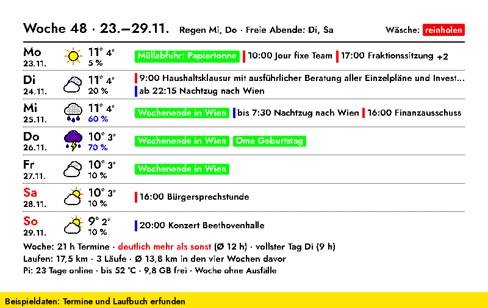

- **Monatsbild:** Am Ersten eines Monats von 6 bis 10 Uhr der ganze Monat: links das Raster mit einem Punkt je Termin in der Kalenderfarbe (höchstens fünf, dann „+“), mehrtägige ganztägige Termine (Reisen) als Band, Wochenenden und Feiertage (NRW) rot, Geburtstage aus der Geburtstagsliste als Törtchen, heute schwarz. Rechts nach Datum: Feiertage, Reisen und Geburtstage (mit Alter). Im Kopf: Zahl der Termine, freie Abende und Feiertage. Das Nachtbild geht vor; ist der Erste ein Sonntag, kommt abends wie gewohnt die Wochenvorschau. Einstellung „Monatsbild“ mit eigenem Zeitfenster.

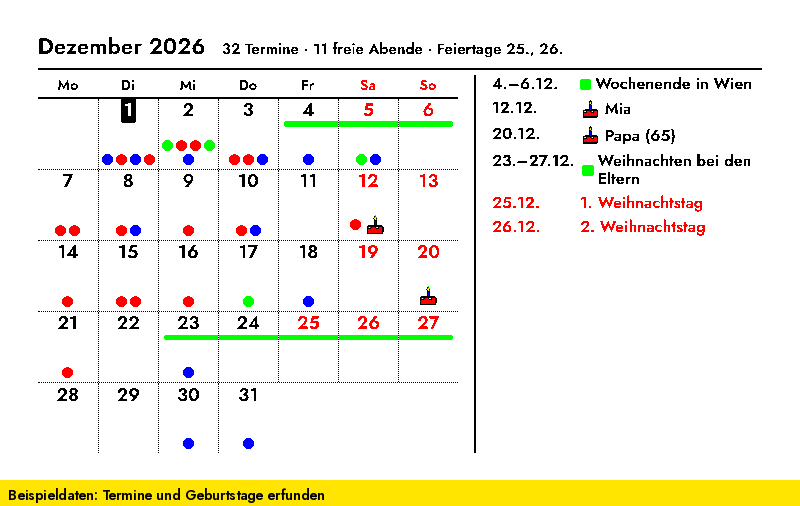

**Laufbuch per iPhone-Kurzbefehl.** Das Dashboard liest eine Textdatei in deiner Nextcloud (Standard `InkyPi/laufen.txt`, mit demselben Zugang wie der Kalender). Eine Zeile je Lauf: Datum, Kilometer, Minuten (Minuten dürfen fehlen):

```
2026-11-22;5,2;31
```

Ein Kurzbefehl „Lauf eintragen“, der nach jedem Lauf die Zeile anhängt (auf dem iPhone nicht geprüft – bitte einmal ausprobieren und die Datei ansehen):

1. **Nach Eingabe fragen** – Zahl, Frage „Wie viele Kilometer?“
2. **Nach Eingabe fragen** – Zahl, Frage „Wie viele Minuten?“
3. **Datum formatieren** – Aktuelles Datum, Datumsformat „Eigenes“, `yyyy-MM-dd`, Zeit „Keine“
4. **Text** – `Formatiertes Datum;Gefragte Eingabe 1;Gefragte Eingabe 2` (die drei Variablen einsetzen, dazwischen Semikolon)
5. **An Textdatei anhängen** – Datei `laufen.txt` im Ordner `InkyPi` der Nextcloud (über die Nextcloud-App in der Dateien-App), „Neue Zeile“ an

Optional als Automation „Wenn ich ein Training beende (Laufen)“ starten. Steht die Datei woanders, den Pfad unter „Wochenvorschau → Laufbuch in der Nextcloud“ eintragen. Komma oder Punkt bei den Kilometern sind beide richtig; Zeilen mit `#` sind Kommentare.

**Einstellungen:** cfgVersion 25. Die vier neuen Schalter sind von selbst an; einmal speichern genügt. Python, Template und CSS haben sich geändert: Ordner `tagesdashboard/` ersetzen und `sudo systemctl restart inkypi.service`. Im Log: `journalctl -u inkypi.service | grep -E "Warnungen|Wochenlast|Laufbuch"`.

## Neu in 1.37: Lauf-Fenster, Glätte-Hinweis, Polarlicht, Nachtbild aufgeräumt

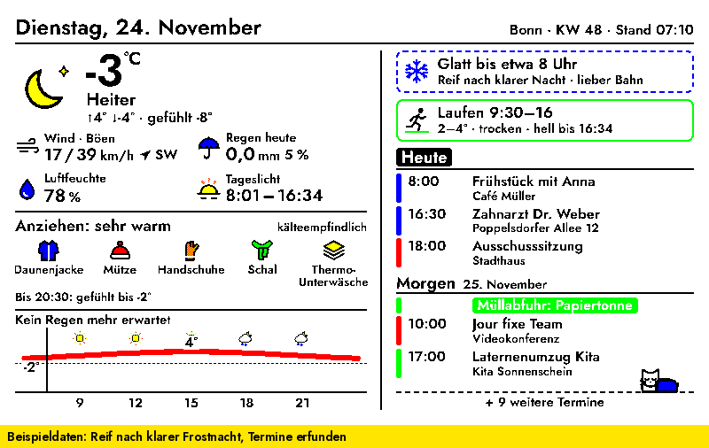

- **Lauf-Fenster:** Eine grün gerahmte Karte über den Terminen nennt die beste Zeit für eine Runde draußen, z. B. „Laufen 9:30–16“ / „2–4° · trocken · hell bis 16:34“. Gesucht wird eine Spanne, die hell ist (Sonnenauf- bis -untergang), trocken (kein Niederschlag, Regenrisiko unter 30 %), −3 bis 26 °C, Böen unter 50 km/h, nicht glatt und frei von Terminen (30 Minuten Puffer davor und danach; ganztägige Termine stören nicht). Von mehreren Spannen gewinnt die mit der angenehmsten Temperatur, wenig Wind und Sonne. Läuft die Spanne schon, heißt es „Laufen jetzt bis 16“. Abends (Wetter für morgen) gilt sie für morgen: „Morgen laufen …“. Passt keine ganze Runde mehr hinein, verschwindet die Karte. Einstellung unter „Wetter“: **Lauf-Fenster** und **Mindestens … min am Stück** (Standard 60).
- **Glätte-Hinweis fürs Rad:** Morgens (5–10 Uhr) eine blau gestrichelte Karte (gestrichelt = eigene Schätzung) „Glatt bis etwa 8 Uhr“ / „Reif nach klarer Nacht · lieber Bahn“. Geschätzt aus der Stundenvorhersage: Reif (Frost, sehr feuchte Luft, klare Nacht), überfrierende Nässe (≤ 1 °C nach Regen in den 12 Stunden davor) oder Schnee (≤ 1 °C nach Schnee in den letzten 24 Stunden). Warnt der DWD selbst vor Glätte, steht seine Warnung im Kopf und die Karte entfällt. Abends für morgen: „Morgen glatt …“. Einstellung **Glätte-Hinweis fürs Rad** unter „Wetter“.
- **Polarlicht im Nachtbild:** Ist für die Nacht ein starker geomagnetischer Sturm vorhergesagt (Kp ab 7, Vorhersage des Space Weather Prediction Center der NOAA), hängt ein grüner Vorhang hinter der Stadt, ab Kp 8 mit roten Spitzen – nur bei überwiegend klarem Himmel; bei Wolken steht nur „Polarlicht möglich, aber bewölkt“ in der Himmelszeile. Für Bonn ist das selten (zuletzt Mai 2024 und November 2025). Einstellung **Polarlicht** unter „Nachtbild“.
- **Nachtbild aufgeräumt:** Statt bis zu vier kleiner Zeilen steht über dem Band nur noch **eine** etwas größere Zeile mit dem Wichtigsten am Himmel in Kurzform, z. B. „Polarlicht möglich ab 23 Uhr · Leoniden aktiv · Venus heute Nacht am hellsten“ (Reihenfolge: Polarlicht, Mondfinsternis, ISS, Sternschnuppen, Planeten; was nicht in die Zeile passt, fällt weg). Ohne Ereignis: „Nacht: sternklar · Vollmond“. Die Tageslänge steht links unter dem Sonnenaufgang („8 h 31 min Tageslicht (−2 min)“). Der Countdown zur Sonnenwende und Details wie Helligkeit oder Richtung der ISS entfallen im Bild (die ISS-Zeile nennt Zeit und Richtung kurz: „ISS morgen früh 5:51 (SW → NO)“).
- **Termine im Nachtbild werden nicht mehr abgeschnitten:** Passt ein Termin nicht mehr ganz in die Spalte, wandert er in „+ N weitere“ (vorher wurde quer der letzte Termin mitten durchgeschnitten).

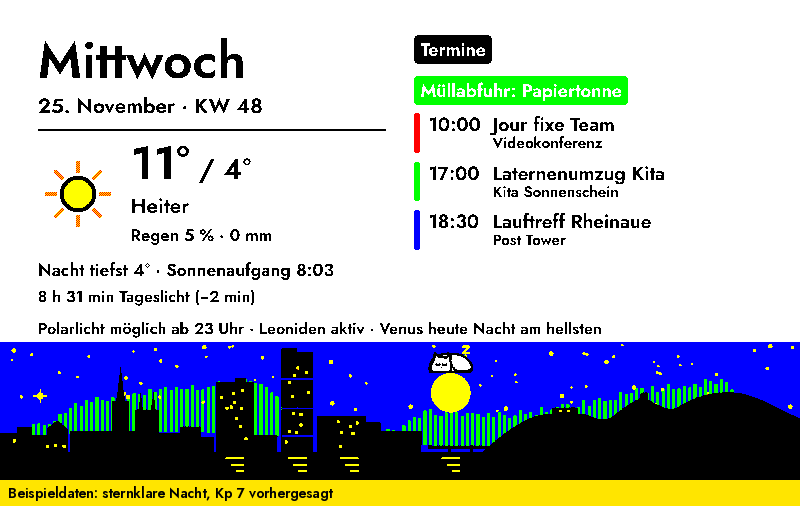

**Einstellungen:** cfgVersion 24. Die drei neuen Schalter sind von selbst an; einmal speichern genügt. Python, Template und CSS haben sich geändert: Ordner `tagesdashboard/` ersetzen und `sudo systemctl restart inkypi.service`. Im Log: `journalctl -u inkypi.service | grep -E "Laufen|Glätte|Polarlicht"`.

## Neu in 1.36: aufgeräumte Wetterseite

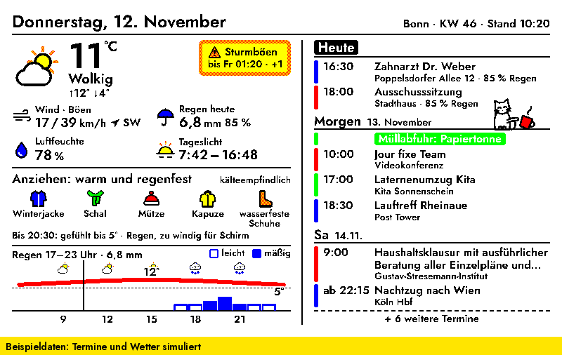

- **Wind und Böen in einer Kachel:** „Wind · Böen 17 / 39 km/h ↗ SW“.
- **UV-Index erst ab Stufe 3** („mittel“, ab da wird Sonnenschutz empfohlen). Im Winter fällt die Kachel weg; im Sommer steht sie als fünfte Kachel in einer eigenen Zeile (siehe `docs/entschlackt_480x800.png`). Die Ersatzkachel „Bewölkung“ für Orte ohne UV-Wert entfällt ebenfalls.
- Meist bleiben so **vier Kacheln** (Wind · Böen, Regen, Luftfeuchte, Tageslicht) in zwei Spalten mit etwas größeren Zahlen.
- **Kleidungsempfehlung ohne Rahmen**, nur mit einer Linie darüber.
- **Tageskurve** ohne die gepunkteten Nachtflächen und mit kräftigerer Linie; sie bekommt den frei gewordenen Platz.
- Keine neue Einstellung. Nachtbild, Wochenvorschau und Festbilder sind unverändert.

**Deine Einstellungen bleiben erhalten** (cfgVersion bleibt 23). Python und CSS haben sich geändert: Ordner `tagesdashboard/` ersetzen und `sudo systemctl restart inkypi.service`.

## Neu in 1.35: 15 weitere Katzenposen

- **Zwei neue Wetterlagen:** Bei **Gewitter** lugt die Katze über die Linie, darüber eine dunkle Wolke mit gelbem Blitz (im Wechsel mit „schaut aus dem Fenster“). Bisher galt Gewitter als Regen. Bei **Nebel** sitzt sie hinter Nebelschwaden. Rangfolge: Sturm > Gewitter > Schnee > Regen > Nebel > Frost > Sonne.
- **Posen zu den Karten**, eingestreut wie Zeitung und Socke (jedes zweite Mal, Wetter geht vor):
  - Regenradar-Karte: späht mit dem **Fernglas**
  - Anfahrt mit dem Rad: **Fahrradhelm**; mit Bus und Bahn: wartet an der **Haltestelle**
  - Pollen-Kachel: **niest** neben einer Blume
  - Wahlkampf-Karte: hält ein rotes **Schild** hoch
  - heute ein Termin mit Wetter am Zielort: studiert die **Landkarte**
- **Ort und Zeit:** ab 22 Uhr **Zipfelmütze** (bis das Nachtbild kommt); am **Wochenende** liegt sie ab und zu in der **Hängematte** (nur jedes vierte Mal, sonst wäre sie das ganze Wochenende dort).
- **Fünf neue Alltagsposen:** Laptop, Kopfhörer, Ball auf der Nase, Papierflieger, Seifenblasen (jetzt 24).
- Keine neue Einstellung. Ohne Katze sowie im Nacht- und Wochenbild ist das Bild unverändert.

**Deine Einstellungen bleiben erhalten** (cfgVersion bleibt 23). Python und CSS haben sich geändert: Ordner `tagesdashboard/` ersetzen und `sudo systemctl restart inkypi.service`.

## Neu in 1.34: 14 neue Katzenposen

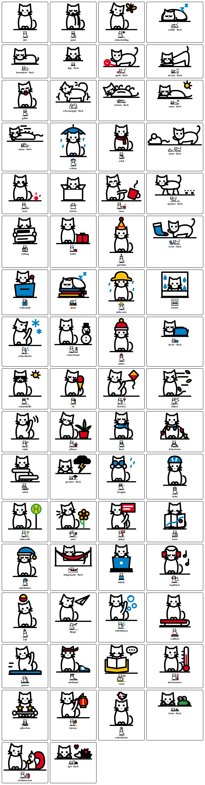

- **Wetterkatze mit Abwechslung:** Jede Wetterlage hat jetzt drei Posen, die sich bei jeder Aktualisierung abwechseln (die Reihenfolge wird jeden Tag neu gemischt, nie zweimal dieselbe hintereinander):
  - Regen: Schirm, **gelber Südwester**, **schaut aus dem Fenster**
  - Schnee: Schal, **fängt eine Flocke**, **mit Schneemann**
  - Frost: Schal, **Bommelmütze**, **unter der Decke**
  - Sonne: Sonnenbad, **Sonnenbrille**, **schleckt ein Eis**
  - Sturm: geduckt, **lässt einen Drachen steigen**, **Blätter wirbeln vorbei**
- Findet eine hohe Wetterpose keinen Platz, nimmt die Katze eine flache Pose **derselben** Wetterlage (unter der Decke, Sonnenbad, geduckt), damit man das Wetter auch auf engen Linien sieht. Bei Regen und Schnee gibt es keine flache Wetterpose, dann wie bisher eine flache Alltagspose.
- **Drei neue Alltagsposen:** Winkekatze, knabbert an der Topfpflanze, Fisch im Maul (jetzt 19).
- **Advent:** Vom 1. Advent bis Heiligabend trägt die Katze ab und zu eine **Lichterkette** (eingestreut wie Zeitung und Socke, nicht immer; Wetter geht vor). Das gilt auch, wenn der Adventskranz ausgeschaltet ist.
- Neue Farbe Grün für Blätter (Displayfarbe; im Schwarz-Weiß-Modus nur Kontur).
- Keine neue Einstellung. Weil die Alltagsreihe länger ist, zeigt die Katze zu einer bestimmten Uhrzeit eine andere Pose als in 1.33. Ohne Katze sowie im Nacht- und Wochenbild ist das Bild unverändert.

**Deine Einstellungen bleiben erhalten** (cfgVersion bleibt 23). Python und CSS haben sich geändert: Ordner `tagesdashboard/` ersetzen und `sudo systemctl restart inkypi.service`.

## Neu in 1.33: Kalenderzugriff abgesichert

Verbesserungen bei der Sicherheit des Nextcloud-Zugangs. Was du dabei wissen musst:

- Das Dashboard merkt sich, zu welcher Nextcloud dein App-Passwort gehört (`src/config/nextcloud_pin.json` neben InkyPis `device.json`). Ziehst du mit der Nextcloud auf eine andere Adresse um, diese Datei auf dem Pi löschen (`sudo rm /usr/local/inkypi/src/config/nextcloud_pin.json`) und die Einstellungen speichern.
- Eine neue Nextcloud-Adresse erst **speichern**, dann aktualisieren.
- Der Name des Schlüssels (unter „Erweitert“) muss mit `NEXTCLOUD_` oder `NC_` beginnen.
- `http://` und „SSL-Zertifikat prüfen“ aus gehen nur bei einer Nextcloud **im Heimnetz** (z. B. `http://nextcloud.local` oder ein selbst signiertes Zertifikat). Eine Nextcloud im Internet braucht `https://`.

**Deine Einstellungen bleiben erhalten** (cfgVersion bleibt 23, das Bild ist unverändert). Der Python-Teil hat sich geändert: Ordner `tagesdashboard/` ersetzen und `sudo systemctl restart inkypi.service`.

## Neu in 1.32: Takt ohne Zug behoben

- Behoben: War der Zug **ausgeschaltet** oder **kein Wochentag** angehakt, zeichnete das Dashboard bei einem Wechselintervall von 5 Minuten (wie für den Zug empfohlen) **den ganzen Tag alle 5 Minuten** neu – „Sonst alle … min“ galt nur mit Zug. Jetzt gilt die eingestellte Aktualisierung (Standard alle 15 min) immer außerhalb eines aktiven Zugfensters; im Zugfenster bleibt es bei 5 Minuten.
- Das Dashboard kennt dafür InkyPis Wechselintervall und verlängert es nie: Bei 15 oder 20 Minuten Wechselintervall wird wie bisher bei jedem Wechsel neu gezeichnet. Nachrichten, Wäsche, Nachtbild usw. erscheinen weiter pünktlich beim ersten Wechsel nach ihrer Uhrzeit.
- „Jetzt aktualisieren“ zeichnet wie bisher immer sofort neu.
- Die Einstellung steht deshalb nicht mehr unter „Zug“, sondern in einem eigenen Abschnitt **„Aktualisierung“** am Ende der Einstellungsseite: „Alle … min neu zeichnen“. Sie lässt sich jetzt auch bei ausgeschaltetem Zug ändern. Dein gespeicherter Wert bleibt erhalten.

**Deine Einstellungen bleiben erhalten** (cfgVersion bleibt 23). Der Python-Teil hat sich geändert: Ordner `tagesdashboard/` ersetzen und `sudo systemctl restart inkypi.service`.

## Neu in 1.31: Nachtbild bis zum Rand

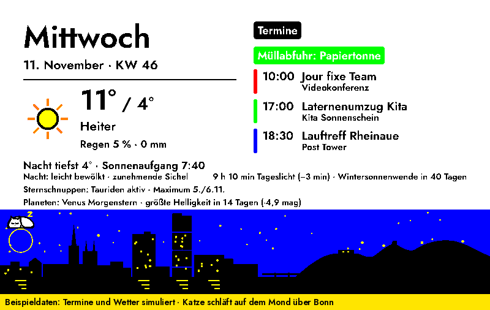

- Die Bonner Silhouette im Nachtbild reicht jetzt **links, rechts und unten bis an den Rand** des Displays – ohne weißen Rahmen, wie Festbild und Urlaubsbild. Das Band ist dabei etwas höher geworden, Bonn wird etwas größer gezeichnet. Text und Termine darüber stehen wie bisher.
- Die Szene wird für jedes Seitenverhältnis passend breit gezeichnet, nicht gestreckt (quer und hochkant).
- Am linken Rand hält der Mond mit Katze etwas Abstand, damit sie nicht an der Kante klebt.
- Behoben: Am Höhepunkt eines Planeten konnte der Punkt der Venus (Morgen-/Abendstern) hinter dem Mond verschwinden. Er weicht ihm jetzt aus.
- Kein Schalter, keine neue Einstellung. Mit ausgeschalteter Silhouette bleibt das Nachtbild, wie es war (mit Rahmen).

**Deine Einstellungen bleiben erhalten** (cfgVersion bleibt 23). Der Python-Teil hat sich geändert: Ordner `tagesdashboard/` ersetzen und `sudo systemctl restart inkypi.service`.

## Neu in 1.30: Wetter am Zielort

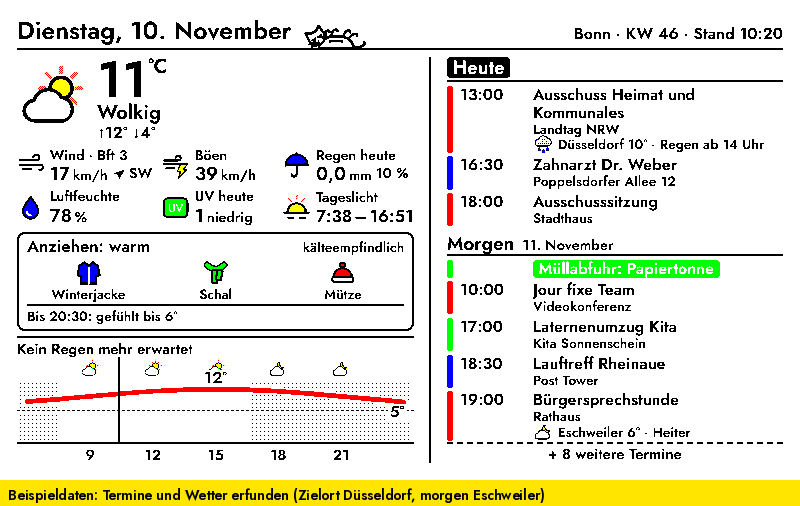

- Liegt ein Termin **mindestens 30 km** vom Wetter-Ort entfernt (Düsseldorf, Aachen; Köln zählt noch als zu Hause), steht unter dem Termin eine Zeile mit dem Wetter dort: „**Düsseldorf 10° · Regen ab 14 Uhr**“ mit kleinem Wettersymbol. Gilt für Termine von **heute und morgen**.
- Ausgewertet wird die **Dauer des Termins**: Temperatur (bei großer Spanne „6–9°“), Regen ab 50 % Wahrscheinlichkeit oder messbarem Niederschlag – „Regen ab 14 Uhr“, wenn er erst während des Termins beginnt, sonst „Regen 80 %“; bleibt es trocken, die Bewölkung („Heiter“, „Stark bewölkt“). Läuft der Termin schon, zählt nur noch der Rest. Abends steht der Mond statt der Sonne.
- Der Regenhinweis am Termin („85 % Regen“), der bisher immer für Bonn galt, entfällt bei solchen Terminen – der Regen am Ziel steht ja in der eigenen Zeile. Der Ort wird auf seinen ersten Teil gekürzt („Landtag NRW“).
- **Wie der Ort gefunden wird:** aus dem Ortsfeld des Termins – „Platz des Landtags 1, 40221 Düsseldorf“, „Rathaus, Eschweiler“, „Köln Hbf“. Straßen, Hausnummern und Links werden übersprungen; es zählen nur echte Orte (in Deutschland jeder, im Ausland nur Großstädte), damit z. B. „Post Tower“ nicht als Städtchen in Texas gilt. **Kurznamen** wie „Landtag“ kennt das Dashboard über „**Eigene Orte**“ bei der Anfahrt („Landtag = 51.2259, 6.7730“) – das gilt auch, wenn die Anfahrt selbst aus ist.
- Die **Kleidungsempfehlung** bleibt beim Wetter-Ort.
- Daten: Geokodierung von Open-Meteo und Bright Sky am Zielort (wie beim Urlaubsbild), ohne Schlüssel; Orte werden gemerkt, das Wetter eine Stunde lang. Fällt der Dienst aus, steht „● Zielort“ in der Statusanzeige und die Zeile fehlt.
- Schalter „Wetter am Zielort“ unter „Termine“, standardmäßig **an**.
- **Behoben (seit 1.16):** Kam im Querformat eine siebte Kachel dazu (Pollenflug), verschwand die Temperaturkurve, und die Stundenzahlen wurden unten abgeschnitten. Jetzt fällt in diesem Fall die Symbolzeile über der Kurve weg (wie beim Wetter-Plugin), wenn es noch enger ist, wird auch die Regenzeile niedriger.

**Deine Einstellungen bleiben erhalten** (cfgVersion 23); der neue Schalter ist von selbst an. Der Python-Teil hat sich geändert: Ordner `tagesdashboard/` ersetzen, `sudo systemctl restart inkypi.service` und die Einstellungen einmal speichern. Prüfen: `journalctl -u inkypi.service | grep Zielort`.

## Neu in 1.29: Adventskranz, freie Abende

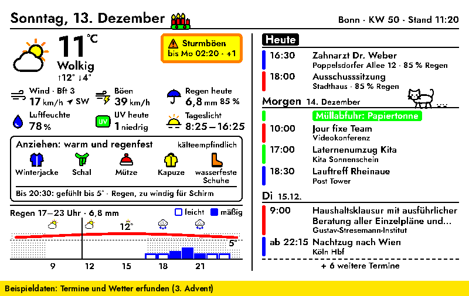

**Adventskranz:**

- Vom 1. Advent bis Heiligabend steht neben dem Datum ein kleiner **Adventskranz**; mit jedem Adventssonntag brennt eine Kerze mehr (von links). Er erscheint im Kopf der normalen Ansicht und am Sonntagabend im Kopf der Wochenvorschau.
- Er steht auf der Kopflinie, die Kopfzeile wird dadurch nicht höher. Wird es im Kopf eng, fällt zuerst „Bonn ·“ weg (z. B. an Heiligabend neben „Frohe Weihnachten“). Reicht das nicht (langer Geburtstagsgruß) oder steht eine Statusmeldung im Kopf, macht der Kranz Platz, damit „Stand …“ und die Meldung ganz zu lesen sind.
- Die Katze bewegt sich davon unabhängig wie immer und weicht dem Kranz nur aus.
- Schalter „Adventskranz“ unter „Festtage und Geburtstage“, standardmäßig an.

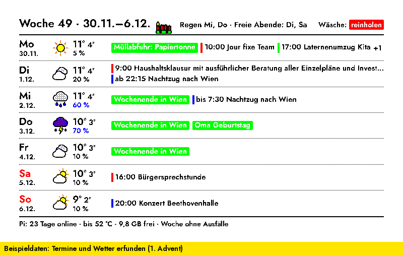

**Freie Abende (Wochenvorschau):**

- Im Kopf der Wochenvorschau steht statt der Zahl der Termine z. B. „**Freie Abende: Di, Sa**“ (ab drei Tagen am Stück als Spanne: „Mo–Mi, Sa“; sonst „keine freien Abende“ bzw. „alle Abende frei“).
- Frei ist ein Abend, wenn kein Termin das **Abendfenster** berührt (Standard **18 bis 22 Uhr**, einstellbar; „bis“ vor „von“ wie 19:00–0:30 geht über Mitternacht) und keine **mehrtägige** ganztägige Abwesenheit eingetragen ist (Reise, Urlaub). Eintägige ganztägige Termine wie Müllabfuhr oder Geburtstage zählen nicht; abgelehnte Einladungen ohnehin nicht. Ist der Kalender nicht erreichbar, steht dazu nichts da.
- Schalter „Freie Abende“ mit dem Abendfenster unter „Wochenvorschau“, standardmäßig an.
- Behoben: Bei Wochen über zwei Monate („30. November – 6. Dezember“) wurde quer das Wäsche-Schild rechts abgeschnitten. Reicht der Platz nicht, steht der Zeitraum jetzt kurz da („30.11.–6.12.“), notfalls stehen Regen und freie Abende untereinander.

**Deine Einstellungen bleiben erhalten** (cfgVersion 22); die beiden neuen Schalter sind von selbst an. Der Python-Teil hat sich geändert: Ordner `tagesdashboard/` ersetzen, `sudo systemctl restart inkypi.service` und die Einstellungen einmal speichern. Prüfen: `journalctl -u inkypi.service | grep Advent` (ab dem 29.11.).

## Neu in 1.28: Rhein auf echtem Pegel, Zustand des Pi

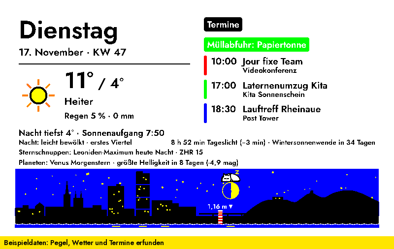

**Rhein auf echtem Pegel (Nachtbild):**

- Unter der Bonner Silhouette fließt der Rhein jetzt **so hoch, wie er am Pegel Bonn gerade steht**: blaues Wasser, darüber die schwarze Ufermauer. Bei Niedrigwasser sieht man viel Mauer, ab etwa 7 m (dort werden laut Stadt Bonn die ersten Uferbereiche überschwemmt) steht das Wasser an den Häusern, bei großem Hochwasser reicht es an die Kennedybrücke.
- An der Brücke steht eine **rot-weiße Pegellatte** (ein Feld je Meter) mit dem Wert darüber, z. B. „1,16 m ▼“. Der Pfeil zeigt, ob der Rhein seit gestern um mindestens 5 cm gestiegen oder gefallen ist.
- Quelle: **PEGELONLINE** der Wasserstraßen- und Schifffahrtsverwaltung (frei, ohne Anmeldung). Abgefragt wird nur, wenn das Nachtbild gezeichnet wird. Ist der Dienst nicht erreichbar oder der letzte Wert älter als 6 Stunden, fließt der Rhein wie bisher.
- Schalter „Rhein auf echtem Pegel“ unter „Nachtbild“, standardmäßig an.

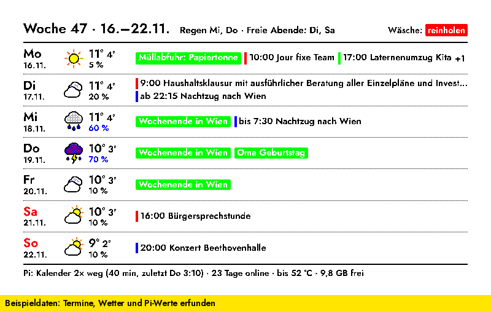

**Zustand des Pi (Wochenvorschau):**

- Sonntags steht unter der Woche eine Zeile wie „**Pi:** Kalender 2× weg (40 min, zuletzt Do 3:10) · 23 Tage online · bis 52 °C · 9,8 GB frei“ – oder „… · Woche ohne Ausfälle“.
- Vorn stehen, was in den letzten 7 Tagen schiefging: **Ausfälle** je Datenquelle (fallen mehrere zugleich aus, z. B. ohne WLAN, steht „Wetter und Kalender 1× weg“), **Neustarts** und **Unterspannung** (dann das Netzteil prüfen). Dahinter: wie lange der Pi läuft, die höchste Temperatur der Woche und der freie Speicher auf der Karte. Ist die Zeile zu lang, fallen hinten Werte weg, hochkant darf sie zwei Zeilen haben.
- Damit die Woche einen Neustart übersteht, merkt sich das Dashboard Ausfälle und Höchstwerte in `InkyPi/src/config/tagesdashboard_pi.json` (nur wenn sich etwas ändert, schont die Speicherkarte; Einträge älter als 9 Tage fallen weg).
- Schalter „Zustand des Pi“ unter „Wochenvorschau“, standardmäßig an.

**Deine Einstellungen bleiben erhalten** (cfgVersion 21); die beiden neuen Schalter sind von selbst an. Der Python-Teil hat sich geändert: Ordner `tagesdashboard/` ersetzen, `sudo systemctl restart inkypi.service` und die Einstellungen einmal speichern. Prüfen: `journalctl -u inkypi.service | grep -E "Pegel|Pi:"`.

## Neu in 1.27: die Katze in der Ratssitzung

- Solange die Livestream-Karte zur Ratssitzung steht, tritt die Katze ans **Rednerpult** (blaues Pult, rotes Mikrofon). Ab **21 Uhr** ist es ihr zu lang geworden: Dann schläft sie auf einem **Stapel Aktenordner**.
- Wie die anderen Anlass-Posen (Zeitung, Koffer, Socke) kommt sie nur bei jeder zweiten Aktualisierung, dazwischen macht sie, was sie sonst auch tut. Sie geht aber dem Wetter vor: Auch bei Regen steht sie am Pult statt unter dem Schirm, und bei der nächsten Aktualisierung hält sie wieder den Schirm.
- Ist die Livestream-Karte ausgeschaltet oder die Sitzung abgelehnt, bleibt alles wie bisher. Keine neue Einstellung (cfgVersion bleibt 20). Der Python-Teil hat sich geändert: Ordner `tagesdashboard/` ersetzen und `sudo systemctl restart inkypi.service`.

## Neu in 1.26: abgelehnte Einladungen ausgeblendet

Termine, zu denen du abgesagt hast, erscheinen nicht mehr – weder in der Terminliste noch in der Wochenvorschau, der Anfahrt oder der Wahlkampf-Karte. Bei Serien fehlt nur der einzelne abgelehnte Termin. Zugesagte, vorläufige und offene Einladungen bleiben, ebenso Termine, bei denen nur andere absagen. Erkannt wirst du an der E-Mail-Adresse deines Nextcloud-Kontos (Persönliche Einstellungen → E-Mail; ohne Adresse bleibt alles wie bisher).

Keine neue Einstellung (cfgVersion bleibt 20). Ordner `tagesdashboard/` ersetzen und `sudo systemctl restart inkypi.service`; neu speichern musst du nichts.

## Neu in 1.25: Livestream der Ratssitzung per QR-Code

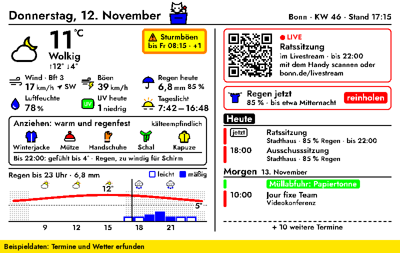

- Solange ein Termin „Ratssitzung“ läuft, steht oben in der Terminliste eine rot gerahmte Karte mit **QR-Code**: Handy-Kamera drauf, und der Livestream der Sitzung öffnet sich. Darunter steht die Adresse zum Abtippen und bis wann die Sitzung geht. Vorher und danach ist das Bild genau wie bisher.
- Der Code führt standardmäßig zu **www.bonn.de/livestream**: Dort verlinkt die Stadt Bonn am Sitzungstag den Stream von Rat und Bezirksvertretungen (der YouTube-Link wechselt mit jeder Sitzung, diese Seite bleibt).
- **Einstellbar** unter „Termine“: Schalter „Livestream während Sitzungen“, Stichwörter im Termintitel (z. B. „Ratssitzung, Bezirksvertretung“) und die Adresse. Kurze Adressen ergeben einen gröberen Code, der sich leichter scannen lässt.
- Auf dem 7,3″-Display ist der Code etwa 17 mm groß (jedes Modul genau 3 Pixel) – aus 10–20 cm Abstand scannen.

**Deine Einstellungen bleiben erhalten** (cfgVersion 20); der neue Schalter ist von selbst an. Der Python-Teil hat sich geändert: Ordner `tagesdashboard/` ersetzen (er enthält jetzt `lib/segno/` für den QR-Code, nichts zu installieren) und `sudo systemctl restart inkypi.service`.

## Neu in 1.24: ein paar Überraschungen

Was es ist, steht hier nicht – sonst wäre es keine Überraschung. Ab und zu lohnt sich ein zweiter Blick aufs Display.

Keine neue Einstellung (cfgVersion bleibt 19). Der Python-Teil hat sich geändert: Ordner `tagesdashboard/` ersetzen und `sudo systemctl restart inkypi.service`; neu speichern musst du nichts.

## Neu in 1.23: Urlaubsbild, Wahlkampf-Karte, ISS-Überflug

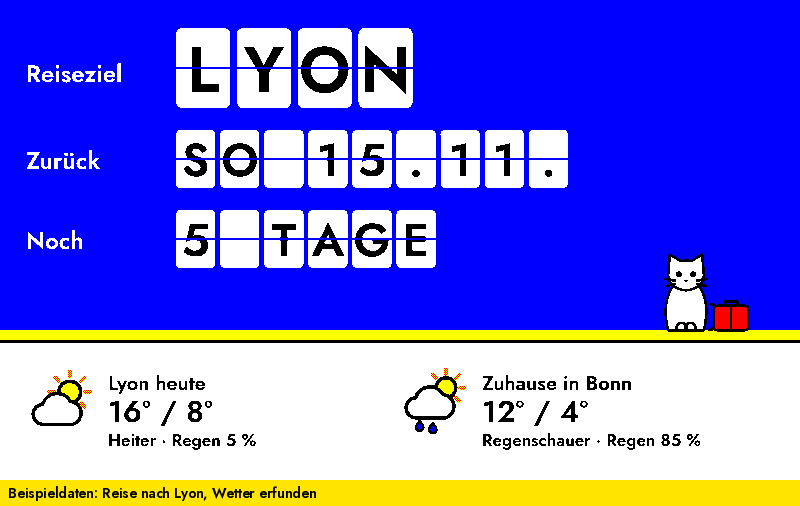

- **Urlaubsbild (Abfahrtstafel):** Steht ein ganztägiger Termin mit „Urlaub“, „Reise“, „Ferien“ oder „Städtetrip“ im Kalender (mindestens 2 Tage), zeigt das Dashboard solange eine Abfahrtstafel: Reiseziel (aus „Urlaub in Lyon“), Rückreisetag, „Noch 5 Tage“ und darunter das Wetter am Ziel neben dem Wetter zu Hause. Das Zielwetter ist eine Zugabe: Findet der Dienst keinen Ort, fehlt nur die Spalte.
- **Wahlkampf-Karte:** Eine Karte über den Terminen, nur an Tagen mit einem Wahlkampftermin („Haustür“, „Infostand“, „Wahlkampf“, „Plakat“, „Verteilaktion“), am Wahltag und am Tag davor; mit Tagen bis zur Wahl. In den Einstellungen wählst du die Wahlart (Landtags-, Bundestags-, Europa-, Kommunalwahl) und den Wahltermin. Für die Landtagswahl NRW (25.4.2027) ist der Termin schon hinterlegt, für die anderen Wahlarten musst du ihn eintragen, sonst bleibt die Karte still.
- **ISS-Überflug (nur Nachtbild):** Eine Zeile wie „ISS morgen früh 5:51: von Südwest nach Nordost · hoch im Südosten · 6 Min · hell“, bei klarem Himmel zusätzlich die Bahn als gestrichelte Linie mit kleiner Station. Gezeigt werden nur auffällige Überflüge (mindestens 25° hoch, hell). Die Bahndaten kommen von Celestrak (höchstens alle 2 Stunden), gerechnet wird auf dem Pi. Vergleiche die Zeiten einmal mit Heavens-Above.

**Deine Einstellungen bleiben erhalten** (cfgVersion 19). Nach dem Update einmal speichern; Urlaubsbild, Wahlkampf-Karte und ISS sind sofort an. Der Python-Teil hat sich geändert: Ordner `tagesdashboard/` ersetzen (er enthält jetzt `lib/sgp4/` für die Bahnberechnung) und `sudo systemctl restart inkypi.service`.

## Neu in 1.22: „4° kälter als gestern“

- Die Begründung unter der Kleidungsempfehlung nennt jetzt den Unterschied zum Vortag: „Bis 20:30: gefühlt bis 5° · 4° kälter als gestern“. So lässt sich die Empfehlung leichter einordnen – wie es sich gestern angefühlt hat, weiß man ja noch.
- **Verglichen wird dasselbe wie in der Empfehlung:** der kälteste gefühlte Wert in der Zeit, in der du unterwegs bist, mit denselben Uhrzeiten gestern (Messwerte des DWD über Bright Sky). Um 15 Uhr also 15–20:30 Uhr heute gegen 15–20:30 Uhr gestern.
- **Abends** (wenn das Dashboard schon den nächsten Tag zeigt) heißt es „5° kälter als heute“.
- Erst **ab 3 Grad** Unterschied, sonst bleibt die Zeile wie bisher (pixelgleich zu 1.21). Fehlen gestern zu viele Stundenwerte, gibt es keinen Vergleich.
- Wird die Zeile zu lang, fallen hintere Gründe weg (z. B. „Regen, zu windig für Schirm“ – der steht ja schon als Symbol darüber). Der Vergleich bleibt.
- Gefühlt heißt mit Windchill: Bei Kälte und Wind kann der Unterschied größer sein als bei der Lufttemperatur.
- Keine neue Einstellung: Der Vergleich gehört zur Kleidungsempfehlung.

**Deine Einstellungen bleiben erhalten** (cfgVersion 18, unverändert). Nur Python- und Template-Dateien haben sich geändert: Ordner ersetzen und InkyPi neu starten. Das Dashboard lädt dafür bei Bright Sky die Stundenwerte ab gestern 0 Uhr statt ab 21 Uhr (etwa 24 Werte mehr).

## Neu in 1.21: Statusanzeige bei Ausfällen

- **Roter Punkt mit dem Namen der Quelle** rechts im Kopf, sobald eine Datenquelle nicht antwortet: „● Radar“, „● Kalender“, „● Zug“, „● GA“ …
- **Nach etwa 2 Stunden** wird daraus der volle Hinweis: „● Kalender seit 9:10 nicht erreichbar“ (über Mitternacht „seit gestern 22:40“).
- Überwacht werden Wetter, UV-Index, Kalender, Zug (samt Störungsmonitor am Ausstieg), Streckenmeldungen, Regenradar, Luftsensoren und UBA-Station, Pollenflug, Anfahrt (Transitous) und jeder Nachrichten-Feed einzeln. Gezeigt wird eine Quelle nur, solange sie gerade gebraucht wird – die Zugdaten vom Dienstagmorgen stehen also nicht die ganze Woche im Kopf. Ein erfolgreicher Abruf lässt den Punkt verschwinden.
- Wird es eng, kürzt das Dashboard selbst: erst „nicht erreichbar“, dann „seit …“, höchstens drei Quellen. Quer passt der volle Satz bei kurzen Namen („GA seit 5:05 nicht erreichbar“), sonst bleibt „Kalender seit 9:10“. Hochkant ist mehr Platz.
- Nur in der normalen Ansicht. Ohne Ausfall ist das Bild pixelgleich zu 1.20. Nach einem Neustart von InkyPi beginnt die Zählung neu.
- Im Log: `journalctl -u inkypi.service | grep Status` zeigt Beginn, Grund und Ende jedes Ausfalls.

**Deine Einstellungen bleiben erhalten** (cfgVersion 18, unverändert, keine neue Einstellung). Nur Python- und Template-Dateien haben sich geändert: Ordner ersetzen und InkyPi neu starten.

## Neu in 1.20: neun neue Katzenposen

- **Fünf neue Alltags-Posen:** jagt eine Maus, starrt auf einen Laserpunkt, sitzt im Karton, schubst eine Tasse von der Kante, spaziert mit Pfotenabdrücken. Damit gibt es 16 Alltags-Posen; wie bisher kommt nie zweimal hintereinander dieselbe.
- **Vier Anlass-Posen**, die passend eingestreut werden: im Nachrichtenfenster liest sie Zeitung, wenn die Zugkarte da ist, steht sie mit rotem Koffer bereit, abends bei der Wäsche-Karte tobt sie mit einer Socke, und am Geburtstag aus deiner Liste trägt sie ein Partyhütchen.
- **Eingestreut, nicht immer:** Eine Anlass-Pose kommt nur bei jeder zweiten Aktualisierung (welche, wechselt von Tag zu Tag), dazwischen ganz normale Posen. Sind mehrere Anlässe zugleich da (z. B. Nachrichten und Zug), wechseln sie sich ab.
- **Vorrang:** Geburtstag vor Wetter vor den übrigen Anlässen. Am Geburtstag trägt sie also auch bei Regen das Hütchen statt den Schirm, die Zeitung dagegen muss bei Regen dem Schirm weichen.
- Keine neue Einstellung: Die Anlass-Posen gehören zur Katze (abschalten mit „Katze“). Ohne Katze ist das Bild pixelgleich zu 1.19.

**Deine Einstellungen bleiben erhalten** (cfgVersion 18, unverändert). Nur Python-Dateien haben sich geändert: Ordner ersetzen und InkyPi neu starten.

## Neu in 1.19: Helle Planeten

**Helle Planeten** (Plugin-Einstellungen → Nachtbild → „Helle Planeten anzeigen“, standardmäßig **an**):

- Im Nachtbild (23–6 Uhr) erscheint unter der Tageslicht-Zeile (bzw. unter den Zeilen zu Sternschnuppen/Mondfinsternis, falls mehrere zutreffen) eine zusätzliche Textzeile, sobald Venus, Jupiter, Mars oder Saturn höchstens 14 Tage von ihrem Höhepunkt entfernt sind: „Planeten: Saturn in 9 Tagen in Opposition (0,3 mag)“. Am Höhepunkt selbst: „Planeten: Saturn heute Nacht in Opposition · die ganze Nacht sichtbar (0,3 mag)“ bzw. bei Venus „… heute Nacht am hellsten · Morgenstern (−4,9 mag)“.
- Anders als bei den Mondfinsternissen verschwindet die Zeile einen Tag nach dem Höhepunkt wieder, auch wenn der Planet real noch monatelang sichtbar bleibt – sonst wäre praktisch ständig irgendein Planet „sichtbar“ und die Zeile keine Besonderheit mehr.
- Nur am Höhepunkt selbst und bei klarem Himmel zeichnet das Nachtbild zusätzlich einen auffällig großen, strahlenden Punkt: Venus (Morgen-/Abendstern) niedrig am Horizont wie der Mond mit Katze, eine Opposition (Jupiter, Mars, Saturn) hoch über dem Siebengebirge.
- Ist kein Planet nah an seinem Höhepunkt, bleibt das Bild wie bisher unverändert.
- **Daten:** von Hand recherchierte Sichtbarkeitsfenster und Höhepunkte für alle vier mit bloßem Auge auffälligen Planeten (mehrere Astronomie-Portale, Stand November 2026) – wie bei den Mondfinsternissen keine jahresperiodische Formel, weil die Umlaufzeiten nicht ins Kalenderjahr passen; die Fenster müssen nach ihrem Ende von Hand aufgefrischt werden.

**Deine Einstellungen bleiben erhalten** (cfgVersion 18). Nach dem Update einmal speichern; helle Planeten sind sofort an.

## Neu in 1.18: Mondfinsternisse

**Mondfinsternisse** (Plugin-Einstellungen → Nachtbild → „Mondfinsternisse anzeigen“, standardmäßig **an**):

- Im Nachtbild (23–6 Uhr) erscheint unter der Tageslicht-Zeile (bzw. unter der Sternschnuppen-Zeile, falls beide zutreffen) eine zusätzliche Textzeile, sobald eine der nächsten von Bonn aus sichtbaren Mondfinsternisse höchstens 45 Tage entfernt ist: „Mondfinsternis in 14 Tagen (20.12.): totale Mondfinsternis · ab 22:43 Uhr, komplett sichtbar“. In der Nacht des Ereignisses selbst: „Mondfinsternis heute Nacht: …“.
- Bei einer **totalen** Mondfinsternis färbt sich der Mond in dieser Nacht zusätzlich rötlich (Blutmond) – Fläche, Kontur und die Spiegelung im Rhein, sofern der Himmel klar genug ist, um den Mond überhaupt zu zeigen. Halbschatten- und partielle Finsternisse bleiben Text ohne Farbeffekt.
- Ist keine Finsternis in Sicht, bleibt das Bild wie bisher unverändert.
- **Daten:** von Hand recherchierte Terminliste der nächsten fünf von Bonn aus sichtbaren Mondfinsternisse (mehrere deutsche Astronomie-Portale, Stand November 2026) – anders als die Sternschnuppenströme keine jährlich wiederkehrende Formel, sondern konkrete Kalendertermine bis Mitte 2030, die irgendwann aufgefrischt werden müssen. Sonnenfinsternisse sind bewusst nicht enthalten (sie finden tagsüber statt und passen nicht zum Nachtbild).

**Deine Einstellungen bleiben erhalten** (cfgVersion 17). Nach dem Update einmal speichern; Mondfinsternisse sind sofort an.

## Neu in 1.17: Sternschnuppenströme

**Sternschnuppenströme** (Plugin-Einstellungen → Nachtbild → „Sternschnuppenströme anzeigen“, standardmäßig **an**):

- Im Nachtbild (23–6 Uhr) erscheint unter der Tageslicht-Zeile eine zusätzliche Textzeile, sobald einer von elf bekannten Meteorströmen aktiv ist: „Sternschnuppen: Perseiden aktiv · Maximum 12./13.8.“ In der Maximumnacht steht statt des Datums die Fallrate: „Perseiden-Maximum heute Nacht · ZHR 100“.
- Bei den drei kräftigsten Strömen (Quadrantiden, Perseiden, Geminiden) zieht das Nachtbild zusätzlich ein paar helle Sternschnuppen über den Himmel – aber nur in der Maximumnacht selbst **und** bei klarem Himmel (sonst bleibt es bei der Textzeile).
- Ist kein Strom aktiv, bleibt das Bild wie bisher unverändert.
- **Daten:** feste Kalendertabelle nach der International Meteor Organization (IMO) – kein Abruf, keine tagesgenaue Berechnung für ein bestimmtes Jahr; das reale Maximum kann um etwa einen Tag abweichen.

**Deine Einstellungen bleiben erhalten** (cfgVersion 16). Nach dem Update einmal speichern; Sternschnuppenströme sind sofort an.

## Neu in 1.16: Pollenflug

**Pollenflug** (Plugin-Einstellungen → Wetter → „Pollenflug anzeigen …“, standardmäßig **an**):

- Erreicht eine ausgewählte Pollenart die eingestellte Stufe, erscheint im Wetterbereich eine zusätzliche, breite Kachel: „Birke mittel +1 weitere“. Ist die Belastung überall gering, bleibt das Bild wie bisher – anders als Luftqualität, Regenradar und Zug bekommt Pollenflug also **keine eigene Karte** in der rechten Spalte, sondern nur eine platzsparende Kachel neben Wind, Böen & Co.
- Gelb = mittel, Rot = hoch (wie bei der Luftqualität); „gering“ ohne Farbe.
- **Alle acht Pollenarten** einzeln abwählbar: Hasel, Erle, Esche, Birke, Gräser, Roggen, Beifuß, Ambrosia. „Zeigen ab“ gering (Standard), mittel oder hoch. Die Teilregion ist voreingestellt auf Bonn, lässt sich aber eintragen, falls der DWD für einen anderen Ort gelten soll.
- **Daten:** Pollenflug-Gefahrenindex des DWD (`s31fg.json`), einmal täglich aktualisiert, ohne Schlüssel.

**Deine Einstellungen bleiben erhalten** (cfgVersion 15). Nach dem Update einmal speichern; Pollenflug ist sofort an.

## Neu in 1.15: Katze auf dem Mond und drei neue Posen

- **Im Nachtbild** (23–6 Uhr, mit Bonner Silhouette) schläft die Katze jetzt eingerollt auf dem Mond: weiß mit schwarzen Linien, darüber ein gelbes „Z“. In diesen Nächten steht der Mond etwas größer und tiefer über dem Rhein zwischen Stadt und Siebengebirge (nie hinter Münster oder Langem Eugen). Wolken schieben sich höchstens vor den Mond, nicht vor die Katze. Das Nachtbild bleibt die ganze Nacht gleich, das Display flackert also nicht.
- **Drei neue Posen** für tagsüber: gähnt, jagt den eigenen Schwanz, liegt ausgestreckt auf dem Rücken. Damit gibt es elf Alltags-Posen plus vier Wetter-Posen.
- Neue Option unter „Katze“: **„Auch im Nachtbild“** (standardmäßig an). Ausgeschaltet sieht das Nachtbild aus wie bisher.

**Deine Einstellungen bleiben erhalten** (cfgVersion 14). Nach dem Update einmal speichern.

## Neu in 1.14: die Katze

**Katze** (Plugin-Einstellungen → Katze, standardmäßig **an**):

- Eine kleine Katze in Linien-Optik sitzt bei jeder Aktualisierung woanders: auf der Kopfzeile, auf der Linie unter „Heute“, „Morgen“ und den anderen Tagen oder auf der gestrichelten Linie über „+ weitere Termine“. Sie wählt nur einen Platz, an dem sie nichts verdeckt; ist nirgends genug frei, fehlt sie.
- **Posen:** sitzt, putzt sich, schaut einem Schmetterling nach, schläft, Kastenbrot, lugt über die Kante, spielt mit dem Wollknäuel, streckt sich (seit 1.15 auch: gähnt, jagt den Schwanz, liegt auf dem Rücken). Zwei Aktualisierungen hintereinander zeigen nie dieselbe Pose. Wo wenig Platz ist, nimmt sie eine flache Pose.
- **Wetterkatze** (Option „Sie passt sich dem Wetter an“, standardmäßig an): bei Regen unter dem Schirm, bei Schnee oder Frost (gefühlt unter 0 °C) mit rotem Schal, bei Sonne ab 15 °C im Sonnenbad, bei Sturmböen ab 60 km/h duckt sie sich und hält sich fest. Es zählt die laufende Stunde, genau wie in der Tageskurve.
- Nur in der normalen Ansicht. Nachtbild, Wochenvorschau und Festbilder bleiben, wie sie sind.
- Ohne Katze ist das Bild pixelgleich zu 1.13. Weil sich „Stand …“ ohnehin bei jeder Aktualisierung ändert, zeichnet das Display ihretwegen nicht öfter neu.

**Deine Einstellungen bleiben erhalten** (cfgVersion 13).

## Neu in 1.13: Streckenmeldungen (Vorwarnung)

**Streckenmeldungen** (Plugin-Einstellungen → Zug → unter „Störungsmeldungen …“ die Option „Auch Störungen und Baustellen auf der Strecke …“, standardmäßig **an**):

- Die Bahn meldet eine Verspätung erst, wenn sie deinen Zug selbst betrifft – die RE 5 um 8:04 fährt aber erst gegen 7 Uhr in Koblenz los. Ist schon um 6:40 zwischen Köln und Leverkusen ein Signal gestört, steht bis dahin „pünktlich“ da. Jetzt erscheint darunter eine **Vorwarnung mit Gleis-Symbol**, z. B. „Strecke Köln-Mülheim–Leverkusen Mitte: Reparatur an einem Signal · seit 6:40“. So kannst du früh überlegen, ob du eine andere Verbindung nimmst.
- Auch **Baustellen** auf deinem Abschnitt („Baustelle Düsseldorf–Köln-Mülheim: Umleitungen und Teilausfälle bis 4.12.“) und **behobene Störungen** (eine Stunde lang: „Behoben: Signal Köln–Köln Messe/Deutz · Verspätungen möglich“).
- Die Vorwarnung ist immer **gelb**. Rot wird die Karte erst, wenn die Bahn deinen Zug selbst als gestört meldet; deren Meldungen (mit „!“) stehen dann zuerst.
- **Nur, was deinen Weg betrifft:** Meldungen zu deiner Linie, die einen Bahnhof oder eine Stadt auf dem Weg deines Zuges bis zum Ausstieg nennen – auch vor deinem Einstieg (z. B. Remagen–Bonn-Bad Godesberg). Abschnitte hinter dem Ausstieg (Duisburg, Oberhausen …) und gleichnamige Linien anderswo (es gibt auch eine RE 5 in Hessen und in Hamburg) bleiben draußen. Dafür muss unter „Zug“ der **Ausstieg** eingetragen sein.
- **Daten:** Fahrplanauskunft des VRR, „Open Service“ über [opendata-oepnv.de](https://www.opendata-oepnv.de/ht/de/api) – frei für private Nutzung, ohne Anmeldung. Die Liste umfasst ganz NRW (etwa 4 MB) und wird darum höchstens alle 10 Minuten geholt, nur im Zeitfenster des Zuges. Der Open Service ist eine Testkopie des VRR; fällt er aus, sieht die Zugkarte aus wie bisher.

**Deine Einstellungen bleiben erhalten** (cfgVersion 12).

## Neu in 1.12: Luftqualität

**Luftqualität** (Plugin-Einstellungen → Wetter → „Luftqualität …“, standardmäßig **an**):

- Ist die Luft draußen **mäßig oder schlechter**, erscheint rechts über den Terminen eine Karte, z. B. „Feinstaub erhöht · mäßig“, darunter „PM2,5 22 · PM10 39 · 9 Sensoren“ (µg/m³) und ein kurzer Hinweis („Anstrengenden Sport draußen meiden“). Gelb = mäßig, Rot = schlecht, dicker roter Rahmen = sehr schlecht. Morgens im Nachrichtenfenster ohne den Hinweis.
- Ist die Luft gut, ändert sich am Bild nichts.
- **Daten:** Feinstaub von den Bürgersensoren auf [sensor.community](https://sensor.community) im Umkreis (Standard 3 km): nur Außensensoren, Median aus mindestens drei, über die letzte Stunde gemittelt. Ersatz ist die amtliche Messstation **Bonn-Auerberg** (DENW062) über die Luftdaten-API des Umweltbundesamts – immer dann, wenn die Luftfeuchte bei 80 % oder mehr liegt (die günstigen Sensoren zählen dann Wassertröpfchen mit und zeigen zu viel) oder wenn zu wenige Sensoren melden. Ist auch die Station nicht erreichbar, zeigt die Karte den Sensorwert gestrichelt mit dem Hinweis „Feucht: Sensoren zeigen oft zu viel“.
- **Einstufung** nach dem Luftqualitätsindex des Umweltbundesamts (Stundenwerte, Klassengrenzen seit 2025): z. B. PM2,5 ab 16 µg/m³ mäßig, ab 31 schlecht, über 50 sehr schlecht.
- **Einstellungen:** „Zeigen ab“ mäßig oder schlecht (mit den strengeren Grenzen seit 2025 ist „mäßig“ recht häufig – wenn dir die Karte zu oft kommt, auf „schlecht“ stellen), Umkreis in km, Messstation (Code beim Umweltbundesamt), und optional **Ozon und Stickstoffdioxid** der Station mitbewerten (standardmäßig aus; im Sommer meldet sich die Karte damit auch bei hohem Ozon).
- Quellen: sensor.community (Open Database License); „Umweltbundesamt mit Daten der Messnetze der Länder und des Bundes“.

**Deine Einstellungen bleiben erhalten** (cfgVersion 11).

## Neu in 1.11: Regenradar und Frankreich

**Regenradar** (Plugin-Einstellungen → Wetter → „Regenradar …“, standardmäßig **an**):

- Kommt in den nächsten zwei Stunden Regen an deinen Wetter-Ort (oder regnet es gerade), erscheint rechts über den Terminen eine Karte: „Regen 16:35–17:05 · mäßig · ab 17:45 wieder“ bzw. „Regen bis etwa 16:55 · danach trocken bis 18:20“. Darunter ein Balken je 5 Minuten, Höhe wie in der Tageskurve; bei starkem Regen roter Rahmen. Morgens im Nachrichtenfenster nur die zwei Textzeilen.
- Bleibt es trocken, ändert sich am Bild nichts.
- Daten: Radar des DWD (Messung und Vorhersage für zwei Stunden) über Bright Sky – frei, ohne Schlüssel. Gezählt wird der stärkste Wert im Umkreis von einem Kilometer, weil das Radar etwa so unscharf ist. Ob Regen oder Schnee, steht nicht im Radar; das Wort kommt aus der Vorhersage.

**Frankreich** (Nachrichten am Morgen → „Dazu eine Schlagzeile aus Frankreich, auf Französisch“, standardmäßig **aus**):

- Vierte Ebene „France“ mit kleiner Trikolore: quer eine Schlagzeile, hochkant bis zu zwei, im Original. Liveticker („DIRECT“) und Videos werden übersprungen, Etiketten wie „ENQUÊTE.“ abgeschnitten.
- Quelle: franceinfo „Les titres“; andere Feeds (z. B. Le Monde `https://www.lemonde.fr/rss/une.xml`) im Feld darunter.
- Wird es eng (z. B. Zug und Radar zugleich), fällt Frankreich als Erstes weg.

**Behoben:** InkyPi sagt dem Browser nicht, dass die Seite UTF-8 ist. Bei vielen Akzenten konnte Chromium deshalb falsch raten, dann stand überall „é“ statt „é“ und „ü“ statt „ü“. Das Dashboard (und Wetter und Kalender ab 1.11) gibt den Zeichensatz jetzt selbst an.

**Deine Einstellungen bleiben erhalten** (cfgVersion 10). Nach dem Update einmal speichern; das Radar ist sofort an, Frankreich musst du einschalten.

## Neu in 1.10: aufgeräumte Einstellungen

Die Einstellungsseite ist neu gegliedert, das Bild auf dem Display bleibt gleich.

- Abschnitte mit Überschrift in der Reihenfolge des Tages: Wetter-Ort, Nextcloud, Wetter, Termine, dann Nachrichten am Morgen, Zug, Anfahrt, Wäsche, Wochenvorschau, Nachtbild, Festtage und Geburtstage (seit 1.32 am Ende zusätzlich „Aktualisierung“).
- Jede Funktion hat einen Hauptschalter; ihre Einstellungen stehen eingerückt darunter und werden blass, wenn sie aus ist. Die Werte bleiben dabei gespeichert.
- Längere Erklärungen (wie Wäsche und Anfahrt entscheiden, Takt und API-Schlüssel beim Zug) stehen hinter „So wird entschieden“ bzw. „Aktualisierung und API-Schlüssel“.
- Wochentage des Zuges als Schalter, Geburtstage auf dem Handy als Karten statt als zu breite Tabelle.
- Name des Schlüssels, SSL-Prüfung und „Schärfer auf Inky-Displays“ stehen unter **Erweitert**. Der Bereich klappt von selbst auf, wenn dort etwas vom Standard abweicht.

**Deine Einstellungen bleiben erhalten:** Alle Schlüssel heißen wie vorher (cfgVersion 9), nichts muss neu eingestellt werden. Behoben: Bei sehr alten Einstellungen ohne Versionsnummer zeigte die Seite ein gespeichertes „aus“ als „an“.

## Neu in 1.8: Anfahrt zu Terminen

Einschalten: Plugin-Einstellungen → **Anfahrt zu Terminen** → „Zeigen, wann ich los muss …“.

- **An jedem Termin** von heute und morgen steht vor dem Ort, wann du los musst: „Los 16:08 · Bus 610“ oder „Los 16:19 · Rad“. Bei Folgeterminen ohne Heimweg dazwischen: „weiter 17:38 · …“ (ab dem Termin davor).
- **Aufbruch-Karte:** etwa 2 Stunden vor der Abfahrt oben über den Terminen – Abfahrt, Verbindung (Verspätung in Rot) und der Grund für Rad oder ÖPNV.
- **Rad nur bei schönem, sicher trockenem Wetter** auf allen Wegen einer Terminkette, jeweils mit einer Stunde Abstand: kein Niederschlag, Regenrisiko unter 30 % (einstellbar), keine Böen ab 50 km/h, keine Glätte. Sonst Bus und Bahn – für die ganze Kette, damit das Rad nicht am falschen Ort steht.
- **Kette:** Termine mit weniger als 90 Minuten Pause (einstellbar). Termine ohne Ort oder mit „Video“, „online“, „Zoom“ … werden übersprungen.
- **Heimweg:** zählt nur, wenn „Auch das Wetter auf dem Heimweg berücksichtigen“ angehakt ist (Standard: aus).
- **Startort:** der Wetter-Ort; abweichend unter „Startort“ (Adresse oder `50.7374, 7.0982`).
- **Ankunft:** 5 Minuten vor Terminbeginn (einstellbar).
- **Eigene Orte:** Wird ein Terminort nicht gefunden (z. B. „Stadthaus“), eine Zeile `Stadthaus = Berliner Platz 2, 53111 Bonn` eintragen.

Daten: [Transitous](https://transitous.org) – frei, ehrenamtlich betrieben, für nicht-kommerzielle Nutzung. Fahrplan und Echtzeit stammen von DELFI; ob Bonner Busse und Bahnen Echtzeit haben, siehst du auf der Karte von Transitous. Ist der Dienst nicht erreichbar, schätzt das Dashboard aus der Entfernung („ca.“), sobald es die Orte einmal kennt.

## Neu in 1.9: Festtage und Geburtstage

Plugin-Einstellungen → **Festtage und Geburtstage** (standardmäßig an):

- **Gruß im Kopf** neben dem Datum: 24.–26.12. „Frohe Weihnachten“, 31.12. „Guten Rutsch“, 1.1. „Frohes neues Jahr“ und an Geburtstagen „Alles Gute, …!“.
- **Festbild:** Heiligabend 17–23 Uhr „Bonn im Schnee“; Silvester ab 22 Uhr Feuerwerk über Bonn mit Fallblattanzeige, um Mitternacht „Frohes neues Jahr 2027“ mit Sektgläsern (bis 2 Uhr). Darunter Datum, Wetter und die Termine des Tages.
- **Geburtstage im Haushalt:** Name, Tag und Monat auswählen, Jahr freiwillig. Fehler werden vor dem Speichern markiert. Am Geburtstag morgens 6–10 Uhr das Festbild: der Name in Folienballons, mit Jahr auch das Alter in Gold.

## Schrift und Schärfe

Siehe `README.md` des Repos (Abschnitt „Schärfer auf dem Inky Impression“): Bildeinstellungen auf 1,0, `inky_saturation` ≤ 0,5, `/etc/fonts/local.conf` mit Autohinter.

## Screenshots (`docs/`)

Mit simulierten Daten (Beispieltermine, Beispielverbindungen):

- `warnung_800x480.png`, `warnung_480x800.png` – Bombenentschärfung am Wetter-Ort: rotes Band aus NINA (erfundene Warnung, 1.38)
- `woche_800x480.png`, `woche_480x800.png` – Wochenvorschau mit „Woche: 21 h Termine · deutlich mehr als sonst“ und Laufen der Woche (1.38)
- `monat_800x480.png`, `monat_480x800.png` – Monatsbild am 1. Dezember: Punkte je Termin, Reisen als Band, Feiertage und Geburtstage (1.38)
- `unterwegs_800x480.png`, `unterwegs_480x800.png` – Reif am Morgen: Glätte-Karte und Lauf-Fenster über den Terminen (1.37)
- `polarlicht_800x480.png`, `polarlicht_480x800.png` – Nachtbild mit Polarlicht (Kp 7), eine Himmelszeile, Tageslicht links (1.37)
- `entschlackt_800x480.png` – aufgeräumte Wetterseite: vier Kacheln, Kleidung ohne Rahmen (1.36)
- `entschlackt_480x800.png` – hochkant im Sommer: UV 7 als fünfte Kachel in eigener Zeile (1.36)
- `anfahrt-bus_800x480.png` – Regen ab 17 Uhr: Bus schon zum ersten Termin der Kette
- `anfahrt-rad_800x480.png` – trockener Abend: Rad
- `anfahrt-verspaetung_800x480.png` – Bus mit 4 Minuten Verspätung
- `anfahrt-morgens_800x480.png` – morgens mit Schlagzeilen
- `anfahrt-bus_480x800.png` – hochkant
- `fest-weihnachten.png`, `fest-silvester.png`, `fest-neujahr.png`, `fest-geburtstag.png` – Festbilder
- `radar_800x480.png`, `radar_480x800.png` – Regenradar: Schauer 16:35–17:05, ab 17:45 wieder Regen
- `nachrichten-frankreich_800x480.png`, `nachrichten-frankreich_480x800.png` – Morgen-Schlagzeilen mit Frankreich
- `luft_800x480.png` – Luftqualität mäßig (Bürgersensoren)
- `luft_480x800.png` – Luftqualität schlecht, hochkant (feuchte Luft: Wert der Messstation)
- `strecke_800x480.png`, `strecke_480x800.png` – Zug pünktlich, darunter Signalstörung auf der Strecke und Baustelle (Beispielmeldungen)
- `katze_800x480.png` – Katze bei Regen unter dem Schirm auf der Kopfzeile
- `katze_480x800.png` – hochkant, bei Frost mit Schal
- `katze_nacht_800x480.png`, `katze_nacht_480x800.png` – Nachtbild: Katze schläft auf dem Mond über Bonn, Band bis zum Rand (1.31)
- `katze_anlass_800x480.png` – im Nachrichtenfenster liest die Katze Zeitung (1.20)
- `katze_anlass_480x800.png` – hochkant, Geburtstag: Partyhütchen geht dem Regenschirm vor (1.20)
- `katze_posen.png` – alle 55 Posen (groß und in Displaygröße, Stand 1.35)
- `status_800x480.png` – Statusanzeige: der GA-Feed ist seit 5:05 nicht erreichbar, Bonn wird mit WDR-Meldungen ergänzt (1.21)
- `status_480x800.png` – hochkant: Kalender seit 9:10 nicht erreichbar (1.21)
- `gestern_800x480.png` – Schnee, gefühlt bis −8° · 4° kälter als gestern (1.22)
- `gestern_480x800.png` – hochkant, abends: morgen 5° kälter als heute (1.22)
- `urlaub_800x480.png`, `urlaub_480x800.png` – Urlaubsbild: Abfahrtstafel mit Zielwetter (1.23)
- `wahlkampf_800x480.png`, `wahlkampf_480x800.png` – Wahlkampf-Karte am Tag mit Wahlkampftermin (1.23)
- `iss_800x480.png`, `iss_480x800.png` – Nachtbild mit ISS-Überflug (erfundene Bahndaten, 1.23)
- `livestream_800x480.png`, `livestream_480x800.png` – während der Ratssitzung: QR-Code zum Livestream (1.25), Katze am Rednerpult (1.27)
- `pegel_800x480.png`, `pegel_480x800.png` – Nachtbild mit dem Rhein auf echtem Pegel: 1,16 m, fallend (1.28)
- `pi_800x480.png`, `pi_480x800.png` – Wochenvorschau mit dem Zustand des Pi: Kalender zweimal ausgefallen (1.28; seit 1.29 mit freien Abenden)
- `advent_800x480.png`, `advent_480x800.png` – 3. Advent: Kranz mit drei brennenden Kerzen im Kopf (1.29)
- `abende_800x480.png`, `abende_480x800.png` – Wochenvorschau am 1. Advent: Kranz und „Freie Abende: Di, Sa“ (1.29)
- `zielort_800x480.png` – Ausschuss im Landtag Düsseldorf: „Düsseldorf 10° · Regen ab 14 Uhr“, morgen Sprechstunde in Eschweiler (1.30)
- `zielort_480x800.png` – hochkant, während des Termins: „Düsseldorf 9° · Regen 80 %“ (1.30)

Die übrigen Bilder stammen aus früheren Versionen: vor 1.38 fehlen in der Wochenvorschau die Zeile „Woche: … h Termine“ (`pi_*`, `abende_*`); vor 1.37 fehlen Lauf-Fenster und Glätte-Karte, und das Nachtbild hat noch mehrere kleine Textzeilen; vor 1.36 zeigen sie noch sechs Kacheln und die Kleidung im Rahmen, ganz alte auch die Katze noch nicht.
