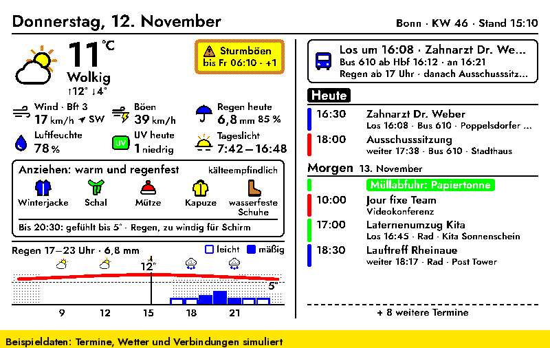
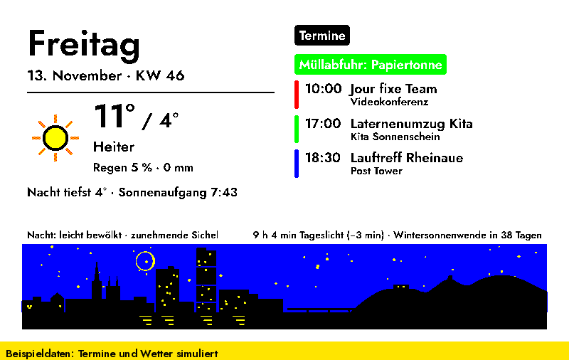
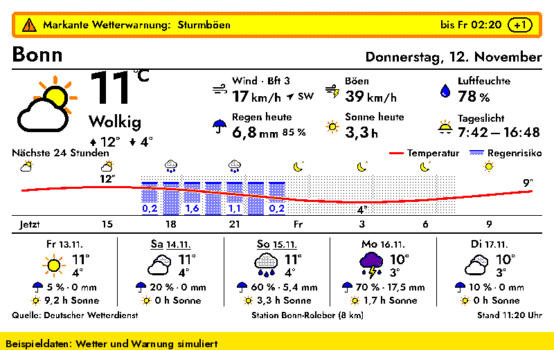
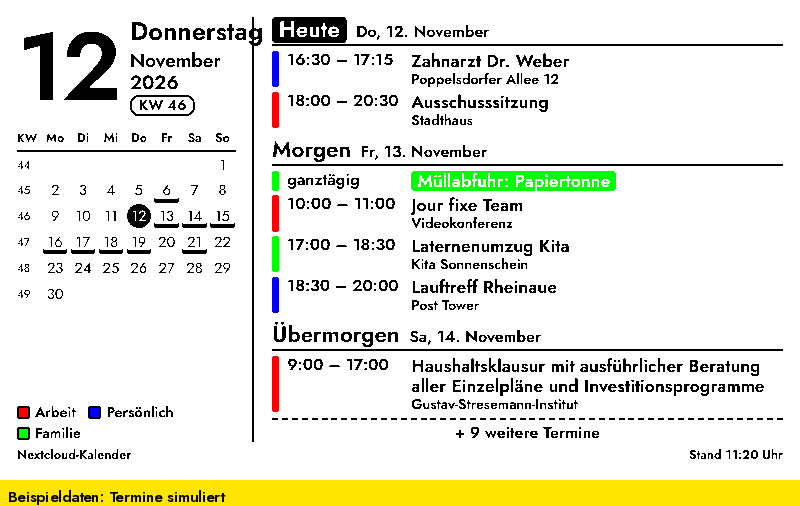

# InkyPi-Plugins: DWD Wetter, Nextcloud Kalender, Tagesdashboard

Drei Plugins für [InkyPi](https://github.com/fatihak/InkyPi), das E-Ink-Display auf dem Raspberry Pi. Alle Texte sind deutsch, die Gestaltung ist für Farb-E-Ink gemacht (getestet auf dem Pimoroni Inky Impression 7,3″, quer und hochkant).



| Ordner | Anzeigename | Inhalt |
|---|---|---|
| [`tagesdashboard`](#tagesdashboard) | Wetter & Kalender | Wetter und Termine auf einem Bild, dazu Kleidung, Anfahrt, Zug, Nachrichten und mehr; eigenständig installierbar |
| [`dwd_wetter`](#dwd-wetter) | DWD Wetter | Wetter vom Deutschen Wetterdienst mit Warnungen, Stundenverlauf und Vorhersage |
| [`nextcloud_kalender`](#nextcloud-kalender) | Nextcloud Kalender | Termine per CalDAV als Terminliste mit Monatsübersicht oder als Wochenansicht |

## Installation

Voraussetzung ist eine laufende InkyPi-Installation. Jedes Plugin lässt sich einzeln installieren:

```bash
inkypi plugin install tagesdashboard https://github.com/<dein-name>/inkypi-plugins
inkypi plugin install dwd_wetter https://github.com/<dein-name>/inkypi-plugins
inkypi plugin install nextcloud_kalender https://github.com/<dein-name>/inkypi-plugins
```

Das Tagesdashboard bringt Wetter- und Kalenderteil selbst mit (Ordner `tagesdashboard/lib/`). Die beiden Einzel-Plugins musst du dafür nicht installieren.

**Manuell oder zum Aktualisieren:** den Plugin-Ordner nach `InkyPi/src/plugins/<id>/` kopieren und `sudo systemctl restart inkypi.service` ausführen. Danach die Plugin-Einstellungen in der Web-Oberfläche einmal öffnen und speichern.

### Zugangsdaten

Passwörter und Schlüssel gehören nicht in die Plugin-Einstellungen, sondern in InkyPis `.env`-Datei (Web-Oberfläche → **API Keys**):

| Schlüssel | Wofür | Pflicht? |
|---|---|---|
| `NEXTCLOUD_APP_PASSWORD` | Nextcloud-App-Passwort (Nextcloud → Einstellungen → Sicherheit → „Neues App-Passwort“) | für Kalender und Dashboard |
| `DB_CLIENT_ID`, `DB_API_KEY` | DB API Marketplace, Timetables-API (kostenlos) | nein; ohne Schlüssel nutzt das Dashboard die öffentliche Abfahrtstafel |

Wetter (DWD), Nachrichten (RSS) und Anfahrt (Transitous) brauchen keine Schlüssel.

## Tagesdashboard

Wetter links, Termine rechts – und je nach Tageszeit, was gerade wichtig ist.

**Immer**

- Wetter des Tages vom DWD: aktuelle Werte, Kacheln (Wind, Böen, Regen, Luftfeuchte, UV-Index, Tageslicht), amtliche Warnungen
- Tageskurve 6–24 Uhr mit Temperatur und Regen
- Kleidungsempfehlung für die Zeit, in der man unterwegs ist (normal, kälteempfindlich oder sehr kälteempfindlich)
- Termine der nächsten Tage aus Nextcloud, mit Kalenderfarben und Ort
- Ab dem Abend (einstellbar, Standard 20 Uhr) Wetter und Kleidung für morgen

**Anfahrt zu Terminen** (einschalten unter „Anfahrt zu Terminen“)

- An jedem Termin von heute und morgen: wann los und womit, z. B. „Los 16:08 · Bus 610“ oder „Los 16:19 · Rad“
- Rad nur bei schönem, sicher trockenem Wetter auf allen Wegen einer Terminkette, sonst Bus und Bahn für die ganze Kette
- Etwa zwei Stunden vor der Abfahrt eine Aufbruch-Karte mit Verbindung, Verspätung und Grund
- Einstellbar: Ankunft vor Terminbeginn, Regenrisiko-Schwelle, Pause zwischen Terminen, Heimweg-Wetter, abweichender Startort, eigene Orte

**Zu bestimmten Zeiten**

- Morgens: Schlagzeilen für Bonn (General-Anzeiger), NRW (WDR) und Bund (tagesschau); Feeds änderbar
- Pendelzug im Zeitfenster: Live-Abfahrt, Gleis, Ankunft am Ausstieg und Störungsmeldungen zu genau dieser Fahrt
- Abends: Soll die Wäsche vom Balkon rein? (Regen, Sturm, Tau, Nebel, Frost bis morgen 10 Uhr)
- Nachts: ein ruhiges Bild für den kommenden Tag mit Bonner Silhouette, Nachthimmel und Mondphase
- Sonntagabends: Vorschau auf die Woche



## DWD Wetter

Wetter vom Deutschen Wetterdienst über [Bright Sky](https://brightsky.dev): aktuelle Werte der nächsten Station, wählbare Messwerte (Wind, Böen, Luftfeuchte, Luftdruck, Regen, Sonne, Tageslicht, Sichtweite, Taupunkt, Bewölkung), amtliche Warnungen, Stundenverlauf für 12 bis 48 Stunden und Vorhersage für 3 bis 7 Tage.



## Nextcloud Kalender

Termine per CalDAV aus Nextcloud, auch Serientermine mit Ausnahmen. Terminliste für 3 bis 30 Tage mit Monatsübersicht oder Wochenansicht (ab heute oder ab Montag), Kalenderfarben aus Nextcloud, Auswahl einzelner Kalender. Aufgabenlisten werden übersprungen.



## Schärfer auf dem Inky Impression

Das Inky Impression 7,3″ kann nur sechs Farben darstellen. Alles andere setzt der Treiber aus farbigen Pünktchen zusammen, dabei fransen Schrift und Linien aus. Zwei Maßnahmen machen das Bild deutlich schärfer:

**1. Farben einrasten (im Plugin, standardmäßig an).** Das Plugin legt jedes Pixel selbst auf eine der sechs Displayfarben fest, bevor das Bild zum Treiber geht. Kanten bleiben dadurch glatt, kräftige Farben werden einfarbig. Nur Graustufen und helle Töne (zum Beispiel die Nachtstunden im Graphen) erscheinen als feines, gleichmäßiges Punktmuster. Abschalten lässt es sich in den Plugin-Einstellungen: „Schärfer auf Inky-Displays“.

Damit das wirkt, in InkyPi unter den Bildeinstellungen (Image Settings) Sättigung, Kontrast, Schärfe und Helligkeit auf **1,0** lassen. Die Inky-Sättigung (`inky_saturation`) bei **0,5 oder weniger** einstellen. Andere Werte verfälschen die Farben wieder; das Plugin schreibt dann eine Warnung ins Log.

**2. Schrift am Pixelraster ausrichten (einmalig auf dem Pi).** Diese Einstellung schaltet den Autohinter von FreeType ein. Er richtet alle Striche einer Schriftgröße auf dieselbe Pixelbreite aus. Die grauen Kantenpixel der geglätteten Schrift macht danach das Einrasten (Punkt 1) hart schwarz oder weiß. So entstehen gleichmäßige Buchstaben ohne graue Ränder:

```bash
sudo tee /etc/fonts/local.conf > /dev/null <<'XML'
<?xml version="1.0"?>
<!DOCTYPE fontconfig SYSTEM "fonts.dtd">
<fontconfig>
  <match target="font">
    <edit name="antialias" mode="assign"><bool>true</bool></edit>
    <edit name="hinting" mode="assign"><bool>true</bool></edit>
    <edit name="autohint" mode="assign"><bool>true</bool></edit>
    <edit name="hintstyle" mode="assign"><const>hintfull</const></edit>
    <edit name="rgba" mode="assign"><const>none</const></edit>
    <edit name="lcdfilter" mode="assign"><const>lcdnone</const></edit>
  </match>
</fontconfig>
XML
fc-cache -f
sudo systemctl restart inkypi.service
```

Der Befehl überschreibt eine vorhandene `/etc/fonts/local.conf`. Er gilt für alle Programme auf dem Pi, die fontconfig nutzen, also auch für andere InkyPi-Plugins. Rückgängig machen: `sudo rm /etc/fonts/local.conf` und InkyPi neu starten.

Bitte nicht Schrift ganz ohne Kantenglättung (`antialias=false`) verwenden. Dann rundet FreeType jeden Buchstaben einzeln auf ganze Pixel, und die Striche werden ungleich dick: „n“ und „m“ wirken dünn, „H“ und Ziffern fett.

**Vorschau:** Die Vorschau in der InkyPi-Weboberfläche zeigt das eingerastete Bild. So sieht es auf dem Display aus, nur leuchtender.

## Aktualisierung und Takt

- Ohne Zug gilt einfach das Aktualisierungsintervall der InkyPi-Playlist (empfohlen: 15 Minuten).
- Mit Zug: Wechsel- und Plugin-Intervall auf 5 Minuten stellen. Außerhalb des Zug-Zeitfensters zeichnet das Dashboard dann nur im eingestellten Takt neu und liefert dazwischen dasselbe Bild. InkyPi erkennt das und lässt das Display in Ruhe.
- Änderungen an CSS und HTML wirken beim nächsten „Jetzt aktualisieren“, Änderungen an Python-Dateien erst nach `sudo systemctl restart inkypi.service`.

## Datenquellen

| Quelle | Wofür | Bedingungen |
|---|---|---|
| [Bright Sky](https://brightsky.dev) / Deutscher Wetterdienst | Wetter, Vorhersage, Warnungen | freie API ohne Schlüssel; Daten: DWD Open Data |
| [DWD UV-Gefahrenindex](https://opendata.dwd.de/climate_environment/health/alerts/uvi.json) | UV-Index im Dashboard | DWD Open Data |
| Nextcloud (CalDAV) | Termine | eigener Server, App-Passwort |
| [Transitous](https://transitous.org) | Anfahrt: Orte, Radrouten, ÖPNV-Verbindungen | ehrenamtlich betrieben, frei für freie und nicht-kommerzielle Anwendungen; Fahrplan und Echtzeit von DELFI |
| Deutsche Bahn, Timetables-API | Pendelzug, Störungsmeldungen | CC BY 4.0 (Deutsche Bahn AG) |
| RSS: General-Anzeiger, WDR, tagesschau | Schlagzeilen | Feeds der Verlage, nur Überschriften |
| [OpenStreetMap](https://www.openstreetmap.org) (Nominatim, Kartenkacheln) | Ortssuche in den Einstellungen | © OpenStreetMap-Mitwirkende, ODbL |

## Entwicklung

Testwerkzeuge liegen in `dev/`. Sie rendern die Plugins mit simulierten Daten, ohne Display, Internet oder echte Nextcloud:

```bash
git clone https://github.com/fatihak/InkyPi ../InkyPi
pip install -r ../InkyPi/install/requirements.txt
pip install -r dev/requirements.txt                 # CalDAV-Testserver (Radicale)

python dev/render.py tagesdashboard                 # Bilder landen in dev/out/
python dev/render.py tagesdashboard --time "2026-11-12 15:10" --trip ok --simulate
python dev/test_anfahrt.py                          # Logik der Anfahrt ohne Rendern
```

Chromium muss im PATH sein (`chromium-headless-shell`, `chromium` oder `chrome`). `--simulate` speichert zusätzlich, wie das Bild nach dem Inky-Treiber aussieht. Alle Optionen, Gestaltungsregeln und bekannten Stolperfallen beschreibt [`CLAUDE.md`](CLAUDE.md).

Wichtig: `tagesdashboard/lib/` enthält Kopien der beiden Einzel-Plugins und wird nie direkt bearbeitet. Änderungen in `dwd_wetter/` bzw. `nextcloud_kalender/` machen und danach `python dev/sync_lib.py` ausführen.

## Lizenz

GPL-3.0, wie InkyPi.
